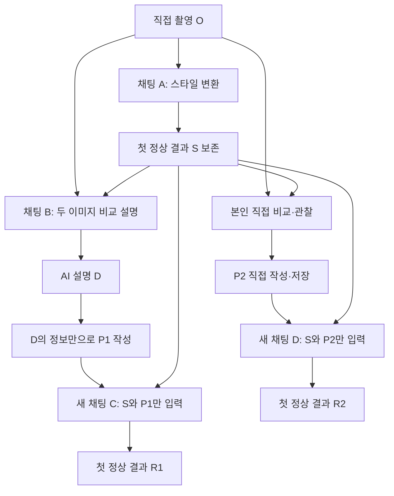

# AI 리터러시 중간과제 리서치와 수행 전략

- 작성·자료 확인일: 2026-10-11
- 기준: [2026학년도 2학기 과제 지시문](2026학년도2학기중간과제물과제명_AI리터러시.md)
- 용도: 실험 준비와 답안 작성 안내. 실제 촬영·이미지 생성·최종 제출 답안 작성은 아직 수행하지 않았다.
- 우선순위: 과제 지시문 → 실제 제출 이미지·프롬프트 → 외부 자료. 외부 자료가 과제 조건을 대체하지 않는다.

## 1. 해결 방향

**좋은 복원 이미지를 만드는 것보다, 두 방법의 정보 출처를 분리하고 첫 정상 결과를 근거로 분석하는 것이 핵심이다.** 이미지 생성은 10점, 비교·분석은 20점이며, 지시문은 원본과의 유사도 자체를 평가하지 않는다고 명시한다.

권장 실험은 직접 촬영한 단순한 정물 사진을 수채화로 변환한 뒤, 같은 서비스를 이용해 두 개의 새 채팅에서 사진 형태로 추정하는 것이다. 먼저 본인의 관찰을 기록하고, 그다음 AI 설명을 받아 방법 1의 프롬프트를 만든다. 이렇게 하면 방법 2에 AI 설명이 섞이는 것을 줄일 수 있다. 이 순서는 지시문에 추가된 의무가 아니라 수행을 돕기 위한 전략이다.

현재 사진과 결과물이 없으므로 어느 방법이 더 잘 복원하는지, 어떤 색이나 물체가 달라지는지는 미리 결론 내릴 수 없다.

## 2. 요구사항을 실행 규칙으로 바꾸기

| 구분 | 지시문에서 요구하는 조건 | 실행·증빙 방법 |
| --- | --- | --- |
| 원본 | 본인이 직접 촬영, 촬영일 메모지를 사진 한쪽에 포함 | 실제 촬영일만 적고 원본 파일 보존 |
| 개인정보 | 얼굴·이름·학번·주소·차량번호·기기 화면 등 식별 정보 금지 | 촬영 전 배경과 반사면 확인 |
| 스타일 | 특정 작가·작품·제작사·캐릭터 이름 금지 | 수채화처럼 일반적인 표현 사용 |
| 방법 1 | AI가 설명한 정보만으로 추정 프롬프트 작성 | 프롬프트의 사실 표현마다 AI 설명 근거 대조 |
| 방법 2 | 본인의 직접 비교·관찰로 프롬프트 작성 | AI 설명을 읽기 전 관찰 메모와 초안 저장 |
| 추정 환경 | 두 방법에 동일 서비스, 각각 새 채팅, 원본 입력 금지 | 두 채팅에 스타일 이미지 한 장씩만 첨부 |
| 결과 선택 | 각 단계의 첫 정상 결과, 여러 장이면 첫 이미지 | 재생성·후보 선택 금지, 오류 때만 재시도 |
| 이미지 | 원본·변환·방법 1·방법 2 총 4장 | 각 이미지에 구분 가능한 캡션 |
| 캡처 | 변환 프롬프트와 결과, AI 설명, 방법 1 프롬프트, 방법 2 프롬프트 | 실제 대화 화면 보존, 긴 내용은 나눠 캡처 |
| 분석 | 세 문항 합계 공백 제외 1,000~1,300자, 각각 250자 이상 | 각 답안과 총합을 따로 계수 |
| 제출 | HWP/HWPX/DOCX 하나, 5MB 이하 | 이미지·캡처·답안을 모두 본문에 삽입 |
| 메타정보 | 서비스명과 과제 수행일 | 표지 또는 실험 개요에 기록 |

원본 촬영일과 AI 작업일이 다르면 각각 정확히 적는다. 연구 문서 작성일을 촬영일이나 실험일로 대신 쓰지 않는다.

## 3. 리서치 결과와 과제에 주는 의미

### 3.1 이미지 변환은 원본 정보를 완벽히 보존하는 과정으로 가정할 수 없다

MUNIT 논문의 고정된 초판 `arXiv:1804.04732v1` 초록은 이미지 변환에서 한 입력에 여러 출력이 대응할 수 있음을 설명하고, 내용과 스타일을 구분하는 접근을 제안한다. 이 개념은 구도와 물체를 보는 항목, 색감과 질감을 보는 항목을 나누는 분석 틀로 참고할 수 있다. 다만 이 논문으로 이번에 사용할 서비스의 내부 구조를 설명할 수는 없다. [MUNIT, v1](https://arxiv.org/abs/1804.04732v1)

**과제에 대한 해석:** 변환 이미지에서 미세한 무늬나 색 정보가 사라지면, 그 이미지와 설명에 부합하는 사진이 여러 개일 수 있다. 그래서 사진처럼 자연스러운 결과와 실제 촬영 원본의 동일성은 별개로 판단해야 한다. 이는 연구 개념을 적용한 추론이며 실제 네 이미지 비교로 확인해야 한다.

예컨대 서로 다른 작은 표면 무늬가 변환 후 동일한 붓 터치로 표현됐다면, 그 터치만으로 어느 무늬가 원본이었는지 확정하기 어렵다. 실제 결과에서 이런 누락이 보일 때만 답안 근거로 사용한다.

### 3.2 실행 후보: Gemini 웹 앱의 무료 기능

Google 공식 도움말은 업로드한 이미지 수정과 여러 이미지 기반 작업을 안내한다. 한도 문서에는 AI 요금제 미가입자의 이미지 생성 이용이 표시되어 있다. 따라서 이미지 비교·변환·추정을 한 서비스에서 수행하는 후보로 검토할 수 있다. 실제 사용 가능 여부와 한도는 계정·지역·시점에 따라 달라지므로 로그인한 계정에서 확인해야 한다. [이미지 생성·수정 안내](https://support.google.com/gemini/answer/14286560?hl=ko), [무료 기능 및 한도 안내](https://support.google.com/gemini/answer/16275805?hl=ko)

**선택 기준:** 결제 없이 이미지 두 장의 비교 설명과 이미지 수정·생성이 가능한지, 대화 화면을 캡처하고 결과를 다운로드할 수 있는지 확인한다. 실행일의 서비스명과 화면에 표시되는 모델명을 기록한다. 방법 1·2에서는 가능한 한 모델과 설정도 동일하게 유지한다. 모델 고정은 비교를 돕는 권장 사항이며, 지시문의 필수 조건은 동일 서비스 사용이다.

새 채팅을 만드는 것에 더해, 제공되는 경우 이전 대화 참조·개인화·연결 자료를 꺼 원본 정보 유입을 줄인다. 새 채팅만으로 서비스 내부 정보 접근이 완전히 차단된다고 단정하지는 않는다. 원본 파일이나 원본이 들어간 문서를 추정 채팅에 첨부하지 않는다.

무료 한도에 도달하면 초기화 안내에 따라 기다린다. 이미 얻은 첫 정상 결과를 보존하고 남은 단계만 이어 간다. 두 추정 중 하나를 다른 서비스로 바꾸지 않는다. 실제 계정에서 기능이 제공되지 않는다면 본 실험 시작 전에 다른 무료 서비스의 조건을 확인한다.

### 3.3 제출 문서의 용량은 이미지 압축으로 관리한다

Microsoft는 데스크톱 Word에서 그림 압축과 잘린 영역 삭제로 문서 크기를 줄이는 방법을 안내한다. 화면에서 그림을 작게 배치하는 것만으로 용량 조건 충족을 판단하지 말고 저장한 파일의 크기를 확인한다. [Word 문서 용량 줄이기](https://support.microsoft.com/en-au/word/reduce-the-file-size-of-your-word-documents)

실행 기준으로 사진·생성 이미지는 JPEG, 글자가 많은 캡처는 PNG를 우선 고려한다. 압축 후 글자와 비교 요소가 읽히는지 확인하며, 최종 파일은 여유 있게 약 4.5MB 이하를 목표로 한다. 이 목표는 학교의 추가 조건이 아니라 5MB 제한을 넘지 않기 위한 작업 기준이다.

## 4. 촬영과 스타일 선택

### 추천 촬영 구성

집 안의 식별 정보 없는 탁자 위에 색과 형태가 다른 사물 2~3개를 놓고, 실제 촬영일을 쓴 메모지를 모서리에 둔다. 예를 들어 무늬 없는 컵, 과일, 작은 화분처럼 개수·상대 위치·색·표면을 설명하기 쉬운 조합이 적합하다. 이것은 촬영 아이디어이며 제출 결과에 대한 사실이 아니다.

- 지나치게 복잡한 배경을 피하고 물체 간 경계가 보이게 촬영한다.
- 카메라 각도와 빛의 방향을 짧게 기록한다.
- 메모지는 읽을 수 있는 크기로 두되 주요 물체를 가리지 않는다.
- 반사면에 얼굴이나 화면이 비치지 않는지 확인한다.
- 개인정보가 있는 사진을 수정해서 쓰기보다 처음부터 조건에 맞게 촬영한다.

### 추천 스타일: 수채화

색면, 윤곽, 그림자, 표면 질감의 변화를 관찰하기 쉬운 일반적인 스타일이므로 수채화를 권한다. 특정 결과를 보장하는 추천은 아니다. 스타일을 결정한 후 다른 스타일을 반복 생성해 더 좋은 후보를 고르지 않는다.

날짜 메모의 숫자가 변형되거나 지워지더라도 결과를 재생성하지 않는다. 정상 생성된 이미지에서의 문자 오류는 분석할 수 있는 변화다. 지시문이 예외로 든 서비스 오류·빈 이미지·깨짐·생성 실패와 단순한 내용 불일치를 구별한다.

## 5. 실험 순서와 채팅 분리

이미지와 텍스트를 작업 중에 다음처럼 부르면 혼동을 줄일 수 있다.

| 표시 | 자료 |
| --- | --- |
| O | 직접 촬영한 원본 |
| S | 첫 정상 스타일 변환 이미지 |
| D | AI가 작성한 O와 S의 차이 설명 |
| P1 / R1 | 방법 1의 프롬프트 / 첫 정상 추정 이미지 |
| P2 / R2 | 방법 2의 프롬프트 / 첫 정상 추정 이미지 |



| 채팅 | 허용 입력 | 목적 |
| --- | --- | --- |
| A: 스타일 변환 | O, 스타일 프롬프트 | S 생성 |
| B: 비교 설명 | O와 S, 비교 요청 | D 확보 |
| C: 방법 1 추정 | S, P1 | R1 생성. O 입력 금지 |
| D: 방법 2 추정 | S, P2 | R2 생성. O와 AI 설명 입력 금지 |

채팅 B를 별도로 두는 것은 증빙을 명확히 하기 위한 권장 구성이다. 추정용 C와 D는 반드시 서로 다른 새 채팅이어야 한다.

1. 촬영 조건을 점검하고 O를 보존한다.
2. 채팅 A에서 한 번 변환 요청하고 S와 실제 화면을 저장한다.
3. **AI 비교 설명을 요청하기 전에** 본인이 O와 S를 비교해 관찰 메모와 P2를 작성·저장한다. 관찰 내용을 다른 AI에게 대신 작성시키지 않는다.
4. 채팅 B에서 O와 S를 구분해 첨부하고 D를 받는다.
5. D에서 제공한 정보만으로 P1을 작성한다. 부족한 설명을 원본을 보고 보충하지 않는다.
6. 새 채팅 C와 D에서 각각 S와 해당 프롬프트만 입력한다. 결과가 마음에 들지 않아도 R1·R2를 보존한다.
7. 네 이미지와 실제 프롬프트를 비교표에 기록한 뒤 분석 답안을 작성한다.

각 단계의 요청·응답·결과를 곧바로 저장한다. 생성 실패가 있었다면 실패 화면과 재시도 이유를 작업 기록에 남긴다. 정상적인 오생성이나 원본과의 불일치 때문에 다시 요청하지 않는다.

## 6. 사용할 수 있는 프롬프트 틀

아래의 대괄호는 실제 근거로 채울 자리다. 예시 속 사물·색·배치를 사실인 것처럼 복사하지 않는다.

### 6.1 스타일 변환: 원본을 첨부한 채팅 A

```text
첨부한 사진을 수채화 스타일의 이미지 한 장으로 변환해 주세요.
사진 속 대상의 개수, 상대적인 위치와 전체 구도를 가능한 한 유지하고,
윤곽과 표면은 수채화의 붓 터치와 색 번짐으로 표현해 주세요.
사진 한쪽에 있는 촬영일 메모지도 가능한 한 유지해 주세요.
```

### 6.2 비교 설명: O와 S를 첨부한 채팅 B

```text
첫 번째 첨부 이미지는 원본 사진이고, 두 번째는 스타일 변환 이미지입니다.
두 이미지를 직접 비교하여 차이점을 설명해 주세요.
대상의 종류와 개수, 색상, 형태, 상대적인 배치, 배경,
표면 질감, 빛과 그림자, 촬영일 메모의 위치와 글자를 살펴봐 주세요.
각 항목에서 원본의 특징과 변환 이미지의 특징을 구분하고,
유지·변형·누락·추가된 정보가 있다면 설명해 주세요.
이미지에서 확인할 수 없는 내용은 추측하지 말고 확인 불가라고 표시해 주세요.
여기서는 설명만 작성하고 이미지를 생성하지 마세요.
```

AI가 어떤 항목을 설명하도록 요청하는 것은 가능하지만, 원본의 색·개수·위치를 질문에 미리 적어 답을 유도하지 않는 편이 정보 출처를 구분하기 쉽다. AI 설명 자체에 오인식이 있다면 몰래 고치지 말고 이후 분석에서 실제 원본과 대조한다.

### 6.3 방법 1: D의 정보만으로 P1 작성

```text
첨부한 스타일 변환 이미지를 바탕으로 원본 사진의 모습을 추정한
사진 형태의 이미지 한 장을 생성해 주세요.

원본에 관한 설명:
[AI 설명 D에 실제로 명시된 대상·개수·색·형태·배치·배경 등만 정리]
```

| P1에 넣으려는 표현 | AI 설명 D의 근거 문장 | 처리 |
| --- | --- | --- |
| [대상과 개수] | [실제 문장 그대로 기록] | 근거가 있으면 사용 |
| [색상과 배치] | [실제 문장 그대로 기록] | 근거가 없으면 삭제 |
| [질감·빛·배경] | [실제 문장 그대로 기록] | 추측을 확정 사실로 바꾸지 않음 |
| [메모의 날짜] | [날짜가 설명됐는지 확인] | 본인이 기억한 날짜로 보충 금지 |

생성 요청 같은 작업 지시는 붙일 수 있지만, D에 없는 장면 정보는 추가하지 않는다. ‘고급 카메라’, ‘오후 햇빛’, ‘나무 탁자’ 같은 장식적 표현도 원본에 대한 새로운 조건이므로 D에 없으면 제외한다. 설명의 ‘붉은색으로 보인다’를 ‘정확히 진홍색’처럼 강화하지 않는다.

P1은 사용자가 D를 읽고 재구성한다. AI 설명에 맞추기 위해 원본 특징을 새로 알려 주는 추가 요청은 피한다. 프롬프트가 짧거나 정보가 부족해도 그대로 실험하면 된다.

### 6.4 방법 2: 본인의 관찰만으로 P2 작성

```text
첨부한 스타일 변환 이미지를 바탕으로 원본 사진의 모습을 추정한
사진 형태의 이미지 한 장을 생성해 주세요.

원본에 관한 설명:
[본인이 두 이미지를 직접 보고 기록한 대상·개수·색·형태·배치·배경]
[본인이 확인한 질감·그림자·메모지 등의 특징]
```

이 틀은 형식 안내일 뿐이다. 대괄호 안의 관찰 사실과 실제 제출 프롬프트는 본인이 직접 작성한다. D나 D를 바탕으로 한 요약·재작성 문장을 가져오지 않는다. 관찰에서 확실히 보이지 않는 내용을 제품명·실측 크기·재질 정보로 추측해 채우지 않는다.

## 7. 캡처와 비교표

### 증빙 목록

| 자료 | 반드시 확인될 내용 | 작업용 이름 예시 |
| --- | --- | --- |
| 원본 이미지 | 실제 사물과 촬영일 메모 | `01_original.jpg` |
| 변환 이미지 | 첫 정상 S | `02_style.jpg` |
| 변환 화면 | 실제 변환 프롬프트와 S | `03_style_chat.png` |
| AI 설명 화면 | D 전체, 첨부 이미지의 구분 | `04_ai_description_01.png` |
| 방법 1 화면 | 실제 입력한 P1 | `05_method1_prompt.png` |
| 방법 1 이미지 | 첫 정상 R1 | `06_method1_result.jpg` |
| 방법 2 화면 | 본인이 작성해 입력한 P2 | `07_method2_prompt.png` |
| 방법 2 이미지 | 첫 정상 R2 | `08_method2_result.jpg` |

캡처 수는 고정하지 않는다. 긴 설명이나 프롬프트는 겹치는 구간을 두고 여러 장으로 나누며, 읽기 어렵게 한 장으로 축소하지 않는다. 추정 채팅에서 S만 첨부된 화면도 함께 남기면 수행 조건을 설명하기 쉽다.

개인정보 영역은 이미지 파일 자체에서 잘라내거나 가린 뒤 문서에 삽입한다. 프롬프트·AI 응답·결과의 의미는 변경하지 않는다. 실제 대화 화면을 재작성한 텍스트나 합성 캡처로 대체하지 않는다. 작업용 파일들은 보관할 수 있지만 제출은 최종 답지 한 파일만 한다.

### 분석용 관찰표

| 비교 요소 | O: 원본 | S: 변환 | D: AI 설명 | P1의 지시 | R1 | P2의 지시 | R2 |
| --- | --- | --- | --- | --- | --- | --- | --- |
| 대상 종류·개수 | | | | | | | |
| 색상 | | | | | | | |
| 형태·윤곽 | | | | | | | |
| 상대적 크기·위치 | | | | | | | |
| 배경 | | | | | | | |
| 표면 무늬·질감 | | | | | | | |
| 빛·그림자 | | | | | | | |
| 날짜 메모·글자 | | | | | | | |

‘원본과 다르다’ 대신 ‘[대상]은 원본에서 [위치/색/형태]였으나 R1에서 [구체적 변화]로 나타났다’처럼 기록한다. 각 칸은 실제 자료를 본 후 채운다.

## 8. 2번 답안의 작성 전략

외부 이론 설명보다 **실제 이미지 요소 → 프롬프트에 담긴 정보 → 결과에서 확인되는 변화 → 신중한 해석** 순서로 쓴다. 세 답안의 본문 합계는 공백 제외 약 1,150자를 목표로 잡으면 수정 여유가 있다.

| 문항 | 권장 분량: 공백 제외 | 반드시 다룰 내용 |
| --- | --- | --- |
| 2-1 | 약 340자 | 유지·변형·누락·추가된 정보와 실제 위치·대상 |
| 2-2 | 약 460자 | R1·R2 각각의 성공·불일치, P1·P2 정보 차이와 결과 연결 |
| 2-3 | 약 350자 | 차이가 난 이유, 동일 재현 가능성에 대한 본인 판단과 관찰 근거 |

### 문항별 작성 골격

**2-1:** 전체 구도나 물체 수 중 유지된 요소를 먼저 설명한다. 이어 색·윤곽·질감의 변형과 실제 누락·추가 사례를 든다. 추가 또는 누락이 확인되지 않았다면 억지로 사례를 만들지 말고 그렇게 적는다.

**2-2:** R1에서 원본 특징을 반영한 부분과 다르게 생성한 부분을 하나 이상씩 찾고, R2에도 같은 비교를 수행한다. P1과 P2의 실제 문구를 대조해 어떤 특징이 명시되었는지 설명한다. 예컨대 한 프롬프트만 위치를 명시하고 해당 결과에서 그 위치가 반영됐다면 ‘명시된 위치 정보가 반영된 것으로 보인다’고 해석할 수 있다. 실제 그런 차이가 없으면 이 예를 쓰지 않는다.

**2-3:** S에서 사라진 정보, D 또는 본인 관찰의 누락·오인, 입력 지시의 반영 한계 등을 실제 사례와 연결한다. 이번 실험에서의 동일 재현 여부와 일반적인 보장 가능성을 구분한다. 대체로 손실된 세부 정보와 생성의 변동성 때문에 동일 원본을 안정적으로 보장하기 어렵다는 판단을 검토할 수 있지만, 관찰 결과에 맞게 본인이 결론을 쓴다.

### 해석에서 지킬 선

- 두 방법 모두 사람 또는 AI의 설명을 통해 원본의 정보를 일부 전달한다. 원본 파일을 입력하지 않았다고 해서 원본 정보가 전혀 없는 실험이라고 쓰지 않는다.
- ‘직접 관찰이 항상 더 정확하다’고 결론 내리지 않는다. 본인 관찰에도 누락이 있을 수 있다.
- 방법별 한 장만 비교하므로 차이가 프롬프트 때문이라고 단정할 수 없다. 확률적 생성과 비공개 서비스 설정도 영향을 줄 수 있다.
- 특정 서비스가 MUNIT 구조나 특정 확산 알고리즘을 쓴다고 외부 논문으로 추정하지 않는다.
- ‘유사하다’와 ‘동일하다’를 구분한다. 픽셀 단위 분석이나 유사도 점수는 과제의 필수 요구가 아니다.

### 글자 수 점검

Word/한글의 공백 제외 글자 수를 확인한다. 다음 PowerShell은 세 답안 본문만 작업용 텍스트에 각각 저장했을 때 사용할 수 있는 보조 점검 방법이다. 제목·표지·프롬프트·참고자료는 넣지 않는다. 파일은 제출하지 않는다.

```powershell
$answerPaths = @('.\answer-2-1.txt', '.\answer-2-2.txt', '.\answer-2-3.txt')
$answerCounts = foreach ($answerPath in $answerPaths) {
    $answerText = Get-Content -LiteralPath $answerPath -Raw -Encoding UTF8
    ($answerText -replace '\s', '').Length
}
$answerTotal = ($answerCounts | Measure-Object -Sum).Sum
$minimumMet = @($answerCounts | Where-Object { $_ -lt 250 }).Count -eq 0
[pscustomobject]@{
    Question1 = $answerCounts[0]
    Question2 = $answerCounts[1]
    Question3 = $answerCounts[2]
    Total = $answerTotal
    MeetsLengthRule = ($minimumMet -and $answerTotal -ge 1000 -and $answerTotal -le 1300)
}
```

이 코드는 공백·줄바꿈 등을 제거한 문자 수를 센다. 문서 편집기의 계수 방식과 차이가 생기면 최종 제출 문서에서도 다시 확인한다.

## 9. 최종 답지 구성과 용량 관리

권장 본문 순서는 다음과 같다. 페이지 수는 지시문에서 별도로 정하지 않았으므로 판독성을 우선한다.

1. 과제 제목, 서비스명, 과제 수행일, 원본 촬영일.
2. 원본 O와 변환 S, 변환 프롬프트·결과 화면.
3. 방법 1의 D 화면, P1 화면, R1 이미지.
4. 방법 2의 P2 화면, R2 이미지.
5. 2-1·2-2·2-3 답안.
6. 제출 체크리스트. 외부 자료를 실제 답안에 활용했다면 짧게 출처 표기.

각 이미지에 ‘그림 1 원본’, ‘그림 2 스타일 변환’, ‘그림 3 방법 1 추정’, ‘그림 4 방법 2 추정’을 붙이고, 캡처는 별도 캡션으로 구분한다. 원본 사진 네 장을 작게 배치한 비교표만으로 제출하지 말고 세부가 식별되는 크기를 확보한다.

용량 초과 시 이미지별 용량을 먼저 확인한다. 사진과 생성 이미지의 해상도·압축률을 조정하고 캡처는 불필요한 여백을 줄인다. Word에서는 그림 압축을 적용한 뒤 저장하고 크기를 확인한다. 캡처의 글자 판독성을 해치지 않는 범위에서 조절한다. 같은 그림을 중복 삽입할 때도 최종 크기를 다시 점검한다.

분석에 사용한 물체·메모지를 자르거나 결과 이미지의 색상·형태를 수정하지 않는다. 품질 판단은 반드시 보존한 원래 결과를 기준으로 한다.

## 10. 제출 전 체크리스트

- [ ] 직접 촬영한 원본에 실제 촬영일 메모지가 보인다.
- [ ] 원본에 금지된 개인정보·식별 정보가 없다.
- [ ] 스타일 프롬프트에 특정 작가·작품·제작사·캐릭터 이름이 없다.
- [ ] 각 단계의 첫 정상 결과를 사용했다. 여러 이미지가 나왔다면 첫 장이다.
- [ ] 오류 재시도와 보기 좋은 결과를 위한 반복 생성을 구분했다.
- [ ] 두 추정은 동일 서비스에서 각각 새 채팅으로 수행했다.
- [ ] 두 추정 채팅에 원본 사진 또는 원본 포함 문서를 넣지 않았다.
- [ ] P1의 모든 원본 사실 표현에 D의 근거가 있다.
- [ ] P2는 본인의 직접 관찰로 작성했고 D를 사용하지 않았다.
- [ ] O·S·R1·R2 네 이미지가 답지 본문에 있다.
- [ ] 변환 프롬프트·결과 화면, D 화면, P1 화면, P2 화면이 본문에 있다.
- [ ] 캡처의 프롬프트와 응답이 읽히며 개인정보가 제거됐다.
- [ ] 세 분석 답안에 제출 이미지·프롬프트의 구체적인 근거가 있다.
- [ ] 세 답안 각각 공백 제외 250자 이상, 합계 1,000~1,300자다.
- [ ] 서비스명과 과제 수행일을 기재했다.
- [ ] 체크리스트 자체를 답지에 포함했다.
- [ ] 최종 파일은 HWP/HWPX/DOCX 하나이며 5MB 이하다.
- [ ] 최종 파일을 다시 열어 이미지 누락·잘림·판독성을 확인했다.
- [ ] 별도 이미지·압축파일·작업 메모를 함께 제출하지 않는다.

## 11. 다음 실행에서 확인할 사항

다음 단계는 촬영과 무료 계정의 기능 확인이다. 실험 후 관찰표를 먼저 채우고 세 답안을 작성한다. 제출 기한과 표지 양식은 제공된 과제 지시문에 없으므로 학교 제출 화면에서 확인한다. 이 문서를 그대로 최종 답지로 제출하지 않는다.

## 참고자료

모두 2026-10-11 확인. 서비스 문서는 이후 변경될 수 있다.

1. 방송통신대학교 AI 리터러시 2026학년도 2학기 중간과제 지시문. 이 폴더의 Markdown 문서.
2. Huang et al. (2018). [Multimodal Unsupervised Image-to-Image Translation, arXiv:1804.04732v1](https://arxiv.org/abs/1804.04732v1). 초록과 버전 이력만 검토.
3. Google. [Gemini 앱으로 이미지 생성 및 수정하기](https://support.google.com/gemini/answer/14286560?hl=ko).
4. Google. [Gemini 앱 액세스·한도·무료 기능 안내](https://support.google.com/gemini/answer/16275805?hl=ko).
5. Microsoft. [Reduce the file size of your Word documents](https://support.microsoft.com/en-au/word/reduce-the-file-size-of-your-word-documents).

외부 자료 검토 범위와 후보별 판단은 [리서치 기록](../../../research/assessments/2026-10-11-ai-literacy-sources.md)에 보존했다.
