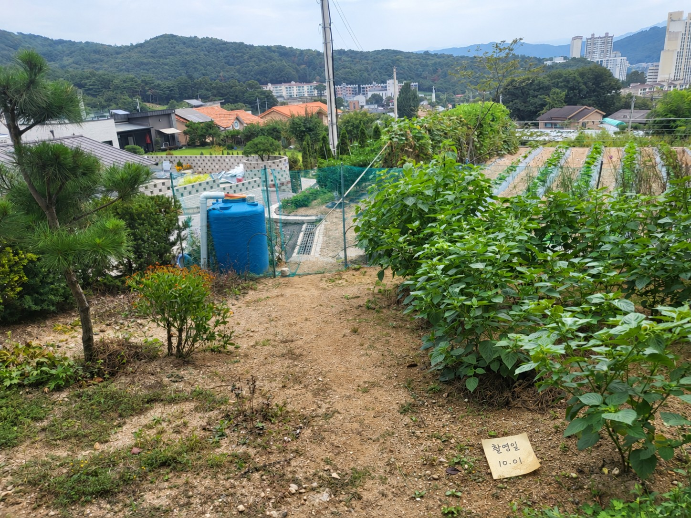
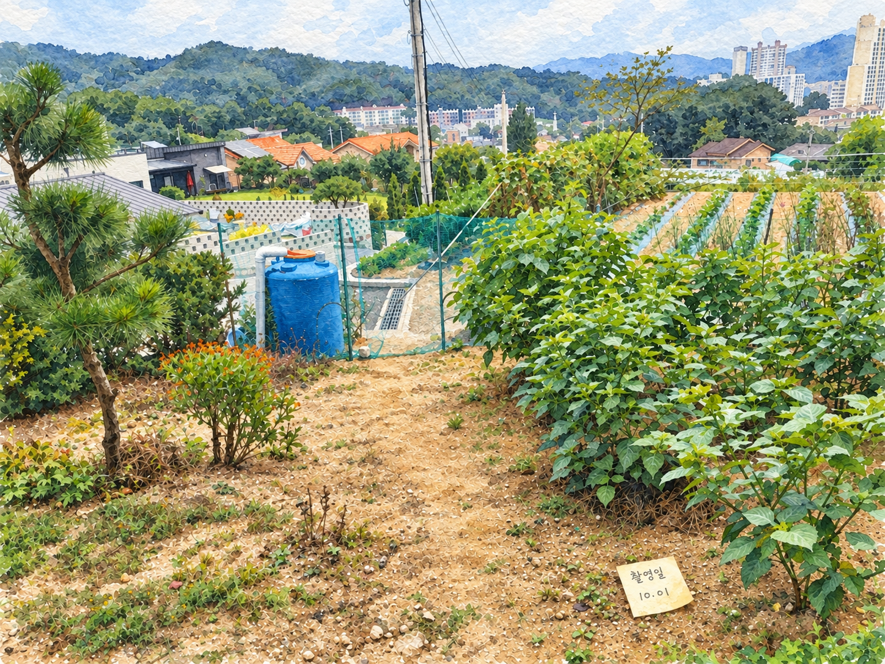
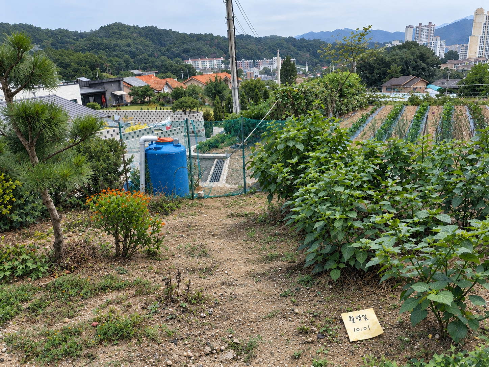
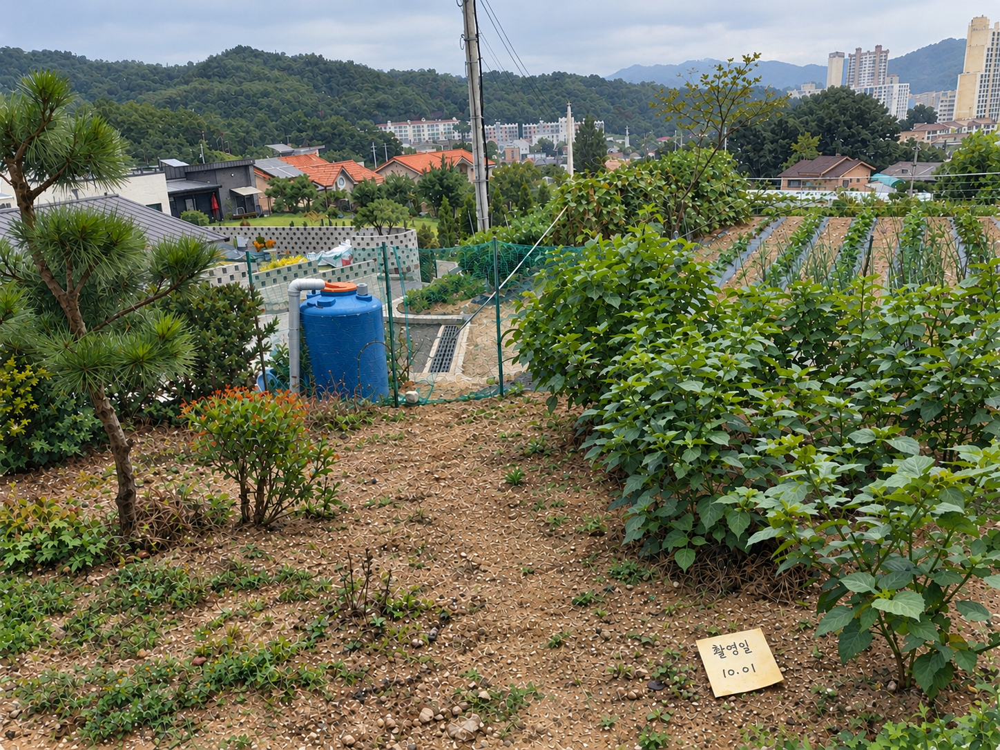

# 생성형 AI를 활용한 이미지의 스타일 변환 및 원본 추정

| 항목 | 내용 |
| --- | --- |
| 교과목 | AI 리터러시 (2026학년도 2학기 중간과제물) |
| 학번 | 153257 |
| 성명 | |
| 사용한 생성형 AI 서비스 | OpenAI Codex (VS Code 확장)의 이미지 생성 기능 |
| 과제 수행일 | 2026-10-12 |

## 1. 스타일 변환과 원본 추정

### 수행 조건

- 스타일 변환, AI 차이 설명, 방법 1 추정, 방법 2 추정을 모두 같은 서비스에서 각각 새 세션으로 수행했다.
- 방법 1과 방법 2의 추정 세션에는 스타일 변환 이미지와 각 방법의 프롬프트만 입력하고 원본 사진은 입력하지 않았다.
- 각 단계에서 첫 번째로 생성된 이미지를 그대로 사용했다.
- Codex가 프롬프트를 임의로 바꾸거나 다른 파일을 참조하지 않도록, 설명·추정 세션에서는 아래 작업 규칙을 프롬프트 앞에 함께 입력했다. 방법 1·2에서 이미지 생성에 실제로 전달된 프롬프트는 입력한 [요청] 원문과 같다.

```text
[작업 규칙 - 반드시 지킬 것]
1. 이 메시지 외의 기록은 보지 마세요. 폴더·파일 탐색(rg, ls, Get-ChildItem 등), 다른 파일 열람, 이전 세션·대화 기록, 메모리, AGENTS.md를 참고하지 마세요. 이미지 생성 도구 사용법(imagegen SKILL.md) 확인만 허용합니다.
2. 사용할 입력은 이 메시지에 명시한 이미지 파일과 아래 [요청] 블록뿐입니다.
3. 이미지를 보고 판단한 내용이나 묘사를 [요청]에 덧붙이지 마세요.
4. Python, OpenCV 같은 코드나 필터로 이미지를 처리하지 마세요.
5. [요청]의 문장을 한 글자도 바꾸지 말고, 번역·요약·확장 없이 그대로 이미지 생성 도구의 prompt로 전달하세요.
6. 이미지 생성 도구를 한 번만 호출해 한 장만 생성하세요. 오류·빈 이미지·생성 실패일 때만 재시도합니다.
7. 생성 후에는 실제로 전달한 prompt 원문과 저장 경로만 보고하세요.
```

AI 차이 설명 세션에서는 5~7번 대신 "이미지를 생성하지 말고 설명만 작성하세요."를 입력했다.

### 원본 사진



그림 1. 원본 사진

### 스타일 변환

**입력한 프롬프트**

```text
첨부한 원본이미지.jpg를 이미지 생성 기능으로 수채화 스타일 이미지 한 장으로 변환해 주세요.
- 전체 구도와 시점, 주요 대상의 개수와 상대적인 위치는 가능한 한 유지해 주세요.
- 윤곽과 표면은 수채화의 붓 터치, 물감 번짐, 종이 질감으로 표현해 주세요.
- 사진 한쪽에 있는 촬영일 메모지도 가능한 한 유지해 주세요.
- Python, OpenCV 같은 코드나 필터로 처리하지 말고 생성형 이미지 모델을 사용해 주세요.
- 이미지는 한 장만 생성하고, 저장한 파일 경로를 알려 주세요.
```

**Codex가 이미지 생성에 실제로 전달한 프롬프트**

Codex는 위 요청을 받아 원본 사진을 확인한 뒤 다음 영어 프롬프트로 확장하여 이미지를 생성했다.

```text
Use case: style-transfer. Input image: the provided 원본이미지.jpg is the edit target. Create exactly ONE watercolor painting of this photograph. Preserve the full landscape framing, aspect ratio, elevated viewpoint, perspective, and the number, scale, and relative positions of all main subjects as closely as possible. Keep the pine tree at left, the single blue cylindrical water tank left of center, the central descending dirt path, dense green plants at right, vegetable rows at upper right, fences, central utility pole and wires, houses and orange rooftops, distant forested hills and buildings, and pale sky. Render the entire scene in authentic watercolor: visible brushwork, translucent washes, soft pigment bleeding, pigment granulation and textured watercolor paper, with sufficiently recognizable shapes. Preserve original natural colors. Especially preserve the small pale yellow handwritten shooting-date memo on the ground near the lower right, its tilted orientation, relative size and location. The handwritten text must read exactly two lines: "촬영일" and "10.01". Keep the memo legible while painting its paper and surroundings in watercolor. No added objects, people, decorative borders, signatures or watermarks. Do not crop or recompose. Generate one image only.
```



그림 2. 스타일 변환 이미지 (수채화)

### 방법 1. AI 설명을 활용한 원본 추정

**AI에게 차이 설명을 요청한 프롬프트** (원본 사진과 스타일 변환 이미지를 함께 입력)

```text
두 이미지를 직접 비교하여 차이점을 설명해 주세요.
대상의 종류와 개수, 색상, 형태, 상대적인 배치, 배경, 표면 질감, 빛과 그림자, 촬영일 메모의 위치와 글자를 살펴봐 주세요.
각 항목에서 원본의 특징과 변환 이미지의 특징을 구분하고, 유지·변형·누락·추가된 정보가 있다면 설명해 주세요.
이미지에서 확인할 수 없는 내용은 추측하지 말고 확인 불가라고 표시해 주세요.
```

**AI가 작성한 설명**

두 이미지는 주요 대상과 전체 배치를 유지하지만, 변환 이미지에서는 사진의 세부 질감이 수채화의 색면과 붓 자국으로 바뀌었습니다.

| 비교 항목 | 원본 사진의 특징 | 수채화 이미지의 특징 및 변화 |
| --- | --- | --- |
| **대상의 종류와 개수** | 왼쪽 나무, 오른쪽의 무성한 식물, 주황색 꽃 무리, 파란 원통형 탱크 1개, 중앙 전신주 1개, 울타리, 밭, 여러 건물, 메모 종이 1장이 보입니다. | 같은 주요 대상이 유지됩니다. 뚜렷하게 추가되거나 완전히 누락된 주요 대상은 확인되지 않습니다. 식물 개체와 건물의 정확한 총개수는 겹침과 거리 때문에 두 이미지 모두 **확인 불가**입니다. |
| **색상** | 식물은 짙고 차분한 녹색이며, 흙은 회갈색에 가깝습니다. 탱크는 파란색, 일부 지붕과 꽃은 주황색입니다. | 색상 구분은 유지되지만 식물의 황록색, 흙의 황토색, 지붕의 주황색이 더 두드러집니다. 밝은 부분과 어두운 부분이 물감의 색면으로 나뉩니다. |
| **형태** | 잎, 나뭇가지, 탱크의 둥근 몸체, 건물과 지붕의 윤곽이 사진의 세부 형태로 보입니다. | 큰 윤곽은 유지됩니다. 개별 잎과 먼 나무는 붓 자국이나 작은 색면으로 단순화되어, 세밀한 모양은 일부 변형되거나 구분하기 어려워졌습니다. |
| **상대적인 배치** | 왼쪽에 나무, 중앙 왼쪽에 탱크, 중앙에 흙길과 전신주, 오른쪽에 식물과 밭이 있습니다. 뒤쪽에는 주택과 산이 놓여 있습니다. | 대상들의 좌우·앞뒤 관계와 크기 비율은 대체로 유지됩니다. 눈에 띄는 주요 대상의 위치 이동은 확인되지 않습니다. |
| **배경** | 숲으로 덮인 산, 먼 건물, 옅은 청회색 하늘이 보입니다. 하늘의 밝기 변화는 비교적 부드럽습니다. | 산 능선과 건물 배치는 유지됩니다. 숲은 녹색·청색 얼룩으로 단순화되고, 하늘에는 흰색과 파란색의 경계가 더 뚜렷한 구름 같은 색면이 나타납니다. 이는 표현상의 추가이며, 실제 구름이 추가된 것인지는 **확인 불가**입니다. |
| **표면 질감** | 흙의 작은 돌과 마른 풀, 잎 표면, 나무껍질, 탱크의 가로 결이 보입니다. | 해당 질감은 일부 유지되지만 붓 자국과 번짐으로 재표현됩니다. 하늘을 비롯한 화면 전반에 수채화 종이처럼 보이는 요철 질감이 추가됩니다. 작은 돌과 잎의 개별 형태는 원본과 정확히 대응하기 어렵습니다. |
| **빛과 그림자** | 잎과 지면에 비교적 부드러운 밝기 차이가 있고, 식물 아래와 잎 사이에는 어두운 부분이 보입니다. | 밝은 잎과 흙이 더 환하게 표현되고, 식물 아래의 어두운 부분은 짙은 녹색 색면으로 강조됩니다. 명암의 대략적인 위치는 유지되지만 세부 그림자 경계는 변형됩니다. 정확한 광원 방향은 **확인 불가**입니다. |
| **촬영일 메모의 위치와 글자** | 오른쪽 아래 흙 위에 비스듬한 연노란색 종이가 있습니다. 윗줄은 **‘촬영일’**, 아랫줄은 **‘10.01’**로 읽힙니다. | 오른쪽 아래의 위치, 종이의 기울기와 두 줄 구성이 유지됩니다. 글자도 **‘촬영일’**, **‘10.01’**로 읽힙니다. 종이에는 물감 얼룩과 종이 질감이 더해졌습니다. 연도와 실제 촬영일의 일치 여부는 두 이미지 모두 **확인 불가**입니다. |

전체적으로 **장면 구성과 메모의 정보는 유지**되었고, **색감·질감·세부 윤곽·명암 표현이 변형**되었습니다. 작은 잎이나 돌처럼 미세한 정보의 개별 유지·누락 여부는 정확히 확인하기 어렵습니다.

**AI 설명을 바탕으로 작성한 원본 추정 프롬프트** (새 세션에 스타일 변환 이미지와 함께 입력)

```text
첨부한 수채화 이미지를 바탕으로, 이 그림의 원본이었을 실제 사진의 모습을 추정한 사진 이미지 한 장을 생성해 주세요.
수채화 이미지의 대상 구성, 좌우·앞뒤 배치와 크기 비율은 유지하고, 수채화의 붓 자국·물감 번짐·종이 요철 질감은 없애 주세요.

원본 사진에 대한 정보:
- 대상과 배치: 왼쪽에 나무, 중앙 왼쪽에 파란색 원통형 탱크 1개, 중앙에 흙길과 전신주 1개, 오른쪽에 무성한 식물과 밭이 있다. 주황색 꽃 무리와 울타리가 있고, 뒤쪽에는 여러 건물과 주택, 숲으로 덮인 산이 있다.
- 색상: 식물은 짙고 차분한 녹색, 흙은 회갈색에 가깝다. 탱크는 파란색, 일부 지붕과 꽃은 주황색이다. 수채화 이미지보다 황록색·황토색·주황색이 덜 두드러진다.
- 형태와 질감: 잎, 나뭇가지, 탱크의 둥근 몸체, 건물과 지붕의 윤곽이 사진의 세부 형태로 보인다. 흙의 작은 돌과 마른 풀, 잎 표면, 나무껍질, 탱크의 가로 결이 보인다.
- 배경: 하늘은 옅은 청회색이며 밝기 변화가 부드럽다.
- 빛과 그림자: 잎과 지면에 부드러운 밝기 차이가 있고, 식물 아래와 잎 사이에 어두운 부분이 있다.
- 메모: 오른쪽 아래 흙 위에 비스듬히 놓인 연노란색 종이 1장이 있고, 윗줄에 '촬영일', 아랫줄에 '10.01'이 쓰여 있다. 종이에 물감 얼룩은 없다.
```



그림 3. 방법 1(AI 설명 활용) 원본 추정 이미지

### 방법 2. 본인의 직접 관찰을 활용한 원본 추정

**본인이 직접 작성한 원본 추정 프롬프트** (새 세션에 스타일 변환 이미지와 함께 입력)

```text
첨부한 수채화 이미지를 바탕으로 이 그림의 원본이었을 실제 사진의 모습을 추정한 사진 이미지 한 장을 생성해.

원본 사진에 대한 정보:
하늘 모양이 색마다 경계가 없이 부드럽게 연결이 되어야 해. 붓이 칠했을 법한 자국이 없어야 해. 원본에 비해서 빛이 너무 밝아졌어. 원본과 달리 촬영일 종이에 나뭇잎 그림자가 잘 안보임.
```



그림 4. 방법 2(직접 관찰 활용) 원본 추정 이미지

## 2. 비교·분석

### 1) 스타일 변환 과정에서 유지·변형·누락·추가된 정보

원본과 스타일 변환 이미지를 비교하면 장면의 구성 정보는 대부분 유지되었다. 왼쪽 소나무, 파란 물탱크, 가운데 흙길과 전신주, 오른쪽 식물과 밭, 뒤쪽 주택과 산의 위치가 그대로이고, 오른쪽 아래 메모지의 기울기와 '촬영일 10.01' 글자도 유지되었다. 반면 표현 정보는 변형되었다. 화면 전체가 밝아졌고, 흙은 회갈색에서 황토색으로, 잎은 짙은 녹색에서 황록색 쪽으로 바뀌었으며, 잎과 먼 숲의 윤곽은 붓 자국과 색면으로 단순화되었다. 흙 속 작은 돌과 잎맥 같은 미세한 형태는 원본과 하나하나 대응하지 않아 사실상 누락되었다. 대신 원본에 없던 종이 요철 질감이 화면 전체에 추가되었고, 하늘에는 흰 구름 같은 색면이, 메모지에는 물감 얼룩이 새로 생겼다. 변환 프롬프트가 구도와 대상 배치의 유지를 요구하면서 수채화 질감을 요구했기 때문으로 보인다.

### 2) 방법 1·2 결과와 프롬프트 정보의 차이

방법 1의 결과는 붓 자국과 종이 질감이 사라지고 흙이 다시 회갈색에 가까워졌으며, 밝기도 원본과 비슷하게 낮아졌다. 그러나 하늘은 원본의 희뿌연 하늘과 달리 파란 하늘에 흰 구름 덩어리가 뚜렷하고, 잎은 윤곽이 딱딱하고 색이 평평한 일러스트처럼 생성되었다. 방법 2의 결과는 잎과 흙이 사진에 더 가깝고 하늘의 경계도 부드러워졌지만, 하늘이 어두운 회색 구름으로 바뀌어 화면 전체가 원본보다 어두워졌다. 두 결과 모두 물탱크의 가로 결 대신 불규칙한 무늬가 생겼다. 방법 1의 프롬프트는 AI 설명을 바탕으로 대상, 색, 질감, 메모를 항목별로 자세히 담았고, '회갈색', '덜 두드러진다' 같은 색 정보는 결과에 반영되었다. 하지만 '탱크의 가로 결', '물감 얼룩은 없다' 같은 세부 지시는 반영되지 않았다. 방법 2의 프롬프트는 하늘, 붓 자국, 밝기, 메모 그림자 네 가지만 짧게 담았는데, 하늘과 붓 자국은 반영되고 밝기는 지나치게 반영되었으며 메모의 나뭇잎 그림자는 생기지 않았다. 대상 배치를 적지 않은 방법 2에서도 구도가 그대로인 것으로 보아, 배치 정보는 프롬프트보다 입력한 수채화 이미지에서 온 것으로 보인다.

### 3) 원본과의 차이가 생긴 이유와 동일 재현 가능성

두 결과가 원본과 다른 가장 큰 이유는 스타일 변환 과정에서 사라진 정보를 되돌릴 수 없기 때문이다. 수채화 이미지에서 작은 돌, 잎맥, 하늘의 실제 상태가 붓 자국으로 덮였으므로, 추정 단계의 AI는 이 부분을 새로 그려 넣을 수밖에 없었고 그 결과 두 방법의 하늘과 탱크 표면, 흙 무늬가 서로 다르게 생성되었다. 또한 프롬프트의 지시가 그대로 반영되지 않았다. 방법 1의 세부 지시와 방법 2의 메모 그림자 요청은 반영되지 않았고, '빛이 너무 밝아졌다'처럼 방향만 준 지시는 정도가 지나쳐 원본보다 어두운 결과가 나왔다. 따라서 원본 사진 없이 원본과 동일한 이미지를 재현하기는 어렵다고 판단한다. 구도와 대상 같은 큰 정보는 복원되지만, 미세한 질감과 빛의 상태는 설명이나 관찰로 정확히 전달하기 어렵고 생성 결과도 매번 달라질 수 있기 때문이다. 다만 방법별로 한 장씩만 생성했으므로 이번 차이를 모두 프롬프트 차이로 단정할 수는 없다.
