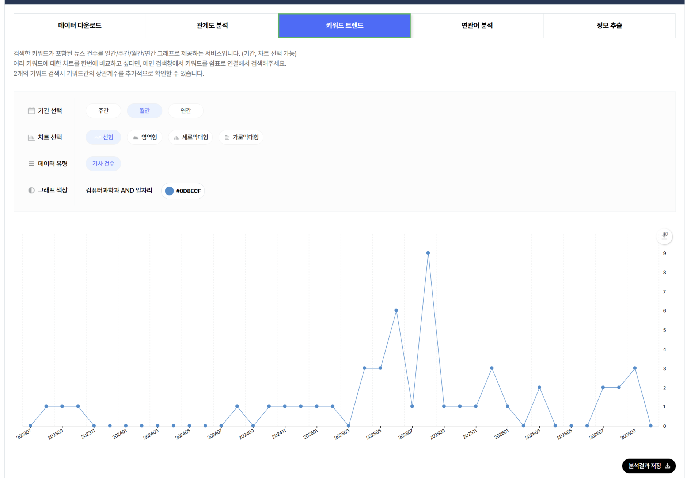
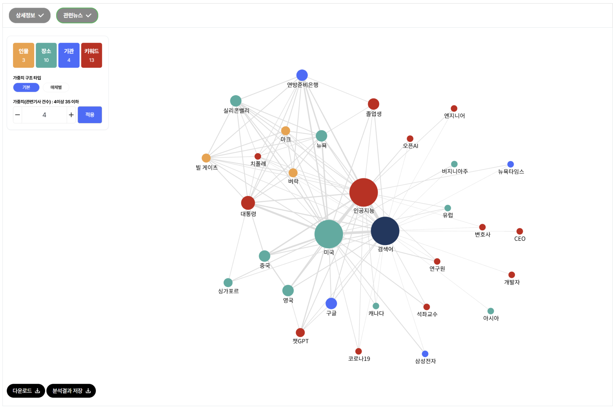
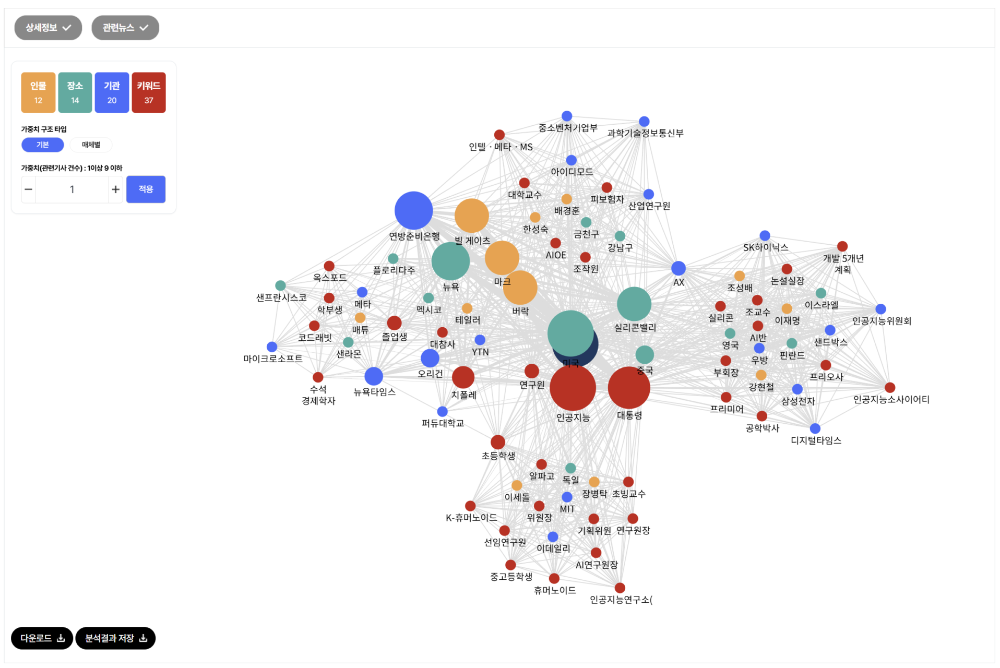

# 2026학년도 2학기 중간과제물

| 구분 | 내용 |
| --- | --- |
| 교과목명 | 빅데이터의이해와활용 |
| 과제유형 | 공통형 |
| 소속 학과 | 컴퓨터과학과 |
| 학번 | 202334-153257 |
| 성명 | 양희석 |

## 1. 웹 스크래핑과 오픈 API에 관한 오류 교정

### 1) 지문의 오류와 교정

#### 가. 웹 스크래핑이 매우 안정적이고 반영구적이라는 설명

웹 스크래핑은 웹페이지에서 필요한 정보를 추출하는 방식이다. 대표적으로 HTML 구조를 분석하고 CSS 선택자나 XPath 등을 이용하여 특정 항목을 가져온다. 크롤링은 링크를 따라 여러 페이지를 탐색하고 수집하는 과정에, 스크래핑은 수집한 페이지에서 필요한 데이터를 추출하는 과정에 초점이 있다. 두 과정은 함께 사용되지만 엄밀하게는 동일한 개념이 아니다. [1]

페이지의 태그, 속성, 배치가 바뀌면 기존 추출 규칙이 맞지 않아 누락이나 오류가 발생할 수 있다. 동적으로 표시되는 내용, 로그인 요구, 접근 제한 등도 수집에 영향을 준다. 수집 조건을 검토하지 않고 웹 스크래핑 자체를 “모범적인 수집 방식”으로 평가하는 것도 타당하지 않다. 따라서 웹 스크래핑을 반영구적인 방식으로 보는 것은 잘못이며, 구조 변경 감지와 추출 결과 검증 등 지속적인 유지보수가 필요하다.

#### 나. 법적·윤리적 문제가 전혀 없다는 설명

인터넷에서 열람할 수 있다는 사실이 무제한 수집과 재이용을 허락한다는 의미는 아니다. 수집 대상과 이용 방법에 따라 저작권, 데이터베이스제작자의 권리, 개인정보, 사이트 이용약관 등을 검토해야 한다. 저작권법은 데이터베이스의 전부 또는 상당한 부분에 관한 제작자의 권리를 규정하며, 작은 부분이라도 반복적·체계적으로 이용하는 경우 문제가 될 수 있다. 따라서 모든 스크래핑이 불법이라고 할 수도 없지만, 아무 문제가 없다고 단정하는 것도 부정확하다. [2]

실무적으로는 요청 간격과 동시 접속 수를 조절하여 서버에 과도한 부담을 주지 않아야 한다. 또한 robots.txt에 표시된 크롤러 접근 규칙을 확인해야 한다. 다만 robots.txt는 접근 권한이나 콘텐츠 이용허락 자체를 부여하는 장치가 아니므로, 이 규칙만으로 수집·재이용의 적법성을 판단할 수는 없다. [1], [3]

#### 다. 오픈 API는 실시간 데이터를 제공할 수 없다는 설명

오픈 API는 제공자가 외부 이용을 위해 공개한 인터페이스이다. 이용자는 정해진 주소와 요청 항목으로 데이터를 요청하고, JSON이나 XML 등 약속된 형식으로 응답을 받는다. 실시간 제공 여부는 API라는 방식 때문에 결정되는 것이 아니라 원천 데이터의 갱신 주기와 제공 시스템의 운영 방식에 달려 있다. 실제로 서울특별시의 버스위치정보조회 API는 버스의 실시간 위치 정보를 제공한다. [4], [5]

따라서 API를 통해 실시간 또는 실시간에 가까운 서비스를 구현할 수 있다. 다만 원천 정보가 반영되는 데 걸리는 시간이나 통신 지연 때문에 실제 현장과 완전히 일치하는 무지연 정보가 항상 보장되는 것은 아니다.

#### 라. 행정 절차가 복잡하여 공공기관 활용 사례를 찾기 어렵다는 설명

오픈 API의 이용 조건은 서비스마다 다르다. 회원가입, 활용 신청, 인증키 발급이 필요한 경우가 있지만 이를 일률적으로 복잡하다고 단정할 수는 없다. 서울 열린데이터광장과 서울시 교통정보시스템 등은 공공데이터를 오픈 API로 제공하고 있다. 따라서 공공기관에서 활용 사례를 찾기 어렵다는 주장은 사실과 다르다. [4], [6]

API를 이용하면 웹페이지의 화면 구조 대신 정해진 데이터 항목을 처리할 수 있어 수집과 후처리를 체계화하기 쉽다. 그러나 API도 호출량 제한, 제공 항목 변경, 서비스 종료 등에 영향을 받을 수 있으므로 항상 안정적이거나 무제한으로 이용할 수 있다고 보아서는 안 된다. 예를 들어 서울교통 빅데이터플랫폼은 API 활용 신청 절차와 일일 호출량 제한을 안내한다. [7]

#### 마. 2009년 서울버스와 2020년 공공마스크 앱을 같은 사례로 묶은 설명

두 사례는 시기와 데이터 제공 방식을 구분해야 한다. 2009년 서울버스는 공공데이터 개방 제도가 충분히 정비되기 전에 웹에 공개된 버스정보를 활용한 초기 사례이다. 개발자 유주완은 직접 작성한 글에서 각 지역 버스정보사이트와 앱을 연결했다고 설명했으며, 특정 지역의 정보 접근이 차단되었다가 이용자들의 항의 이후 해제된 경험도 소개했다. 이는 공공정보의 민간 활용 수요와 안정적인 개방 체계의 필요성을 보여준다. 초기 서울버스를 처음부터 현재와 같은 공식 오픈 API 기반 서비스였다고 단정하여 교정하는 것 역시 피해야 한다. [8]

반면 2020년 공공마스크 앱은 정부가 개방한 판매정보 API를 민간이 활용한 대표적인 사례이다. 정부는 2020년 3월 10일 공적 마스크 판매 데이터를 공개하면서, 건강보험심사평가원이 제공한 데이터를 한국정보화진흥원이 가공하고 네이버 클라우드를 통해 오픈 API로 제공한다고 밝혔다. 민간 개발자들은 이를 이용해 판매처와 재고 정보를 알려주는 웹·앱 서비스를 개발할 수 있었다. 따라서 마스크 앱까지 서울시 버스정보 사이트를 스크래핑하여 만들었다는 지문의 설명은 데이터의 대상과 수집 경로를 모두 혼동한 것이다. [9]

법률의 시점도 틀렸다. 「공공데이터의 제공 및 이용 활성화에 관한 법률」은 2013년 7월 30일 공포되어 같은 해 10월 31일 시행되었다. 2009년은 이 법의 시행 전이지만, 2020년은 시행 이후이다. 또한 해당 법이 없었다는 사실만으로 데이터를 제공하거나 API를 운영하는 것이 기술적으로 불가능했다고 추론할 수도 없다. [10], [11]

### 2) 교정한 답변

웹 스크래핑과 오픈 API는 인터넷상의 데이터를 수집하는 데 활용할 수 있지만, 데이터에 접근하고 처리하는 방식이 다르다. 웹 스크래핑은 웹페이지의 HTML 등을 분석하여 필요한 정보를 추출하는 방식이다. 별도의 API가 없는 웹페이지에도 적용할 수 있지만, 페이지 구조 변경이나 접근 제한에 따라 수집 프로그램이 작동하지 않을 수 있어 유지보수가 필요하다. 또한 공개된 정보라도 저작권, 데이터베이스제작자의 권리, 개인정보 및 이용약관을 검토해야 하며, 과도한 요청으로 서버 운영에 부담을 주지 않아야 한다. [1], [2]

오픈 API는 제공자가 정한 규격에 따라 데이터를 요청하고 JSON이나 XML 등의 형식으로 받는 인터페이스이다. 정해진 항목으로 데이터를 받아 자동 처리하기에 편리하며, 원천 데이터와 시스템의 갱신 주기에 따라 실시간 정보도 제공할 수 있다. 서울시 버스위치정보조회 API가 그 예이다. 다만 인증키, 호출량 제한, 이용허락 조건과 API 변경 여부 등을 확인해야 한다. 따라서 실무에서는 필요한 항목과 갱신 주기를 충족하는 공식 API가 있는지 먼저 확인하고, 웹 스크래핑이 필요한 경우에는 이용 조건과 유지보수 비용을 함께 고려하는 것이 합리적이다. [4], [5], [7]

활용 사례도 구분해야 한다. 2009년 서울버스는 웹에 공개된 버스정보를 민간이 활용한 초기 사례로서, 정보 접근 차단 논란을 통해 공공데이터 개방의 필요성을 드러냈다. 반면 2020년 공공마스크 앱은 공적 마스크 판매정보를 오픈 API로 개방하고 민간이 이를 활용하여 서비스를 만든 사례이다. 공공데이터법은 2013년 10월 31일부터 시행되었으므로 두 사례를 모두 법률 제정 이전의 스크래핑 사례로 묶는 것은 잘못이다. 두 사례의 차이는 공공정보를 웹에서 활용하던 초기 상황과, 정부가 데이터 제공 통로를 마련하여 민간의 서비스 개발을 지원한 상황의 차이를 보여준다. [8], [9], [11]

## 2. 빅카인즈를 활용한 컴퓨터과학과·일자리 뉴스 분석

### 1) 검색 조건과 시각화 결과

소속 학과인 컴퓨터과학과와 ‘일자리’를 결합하여, 컴퓨터과학 전공 및 관련 산업의 고용 문제가 뉴스에서 어떻게 다뤄지는지 살펴보았다. 검색과 시각화에는 빅카인즈의 뉴스 분석 기능을 사용하였다. [19]

| 항목 | 설정 및 결과 |
| --- | --- |
| 플랫폼 | 한국언론진흥재단 빅카인즈 |
| 검색식 | `컴퓨터과학과 AND 일자리` |
| 전체 기간 | 2023-07-12~2026-10-12 |
| 검색 유형·범위 | 뉴스, 제목+본문 |
| 검색어 처리 | 형태소/바이그램 분석 |
| 추가 조건 | 기고자명 및 추가 포함·제외어 없음 |
| 전체 검색 결과 | 49건 |
| 시간 시각화 | 월간·선형·기사 건수 |
| 전체 기간 관계도 | 가중치 구조 ‘기본’, 관련 기사 건수 하한 4 |
| 집중 분석 기간 | 2025-08-01~2025-08-31, 검색 결과 9건 |
| 집중 기간 관계도 | 가중치 구조 ‘기본’, 관련 기사 건수 하한 1 |

그림 1. ‘컴퓨터과학과 AND 일자리’의 월별 기사 건수. 기간: 2023-07-12~2026-10-12. 출처: 빅카인즈, 직접 검색·시각화, 2026-10-12.

그림 2. 전체 검색 기간의 개체 연결 관계. 가중치 구조: 기본, 관련 기사 건수 하한: 4. 화면상 인물 3개·장소 10개·기관 4개·키워드 13개. 출처: 빅카인즈, 2026-10-12.

그림 3. 보도량 최고점인 2025년 8월의 개체 연결 관계. 기간: 2025-08-01~2025-08-31. 가중치 구조: 기본, 관련 기사 건수 하한: 1. 화면상 인물 12개·장소 14개·기관 20개·키워드 37개. 출처: 빅카인즈, 2026-10-12.

그림 2와 그림 3은 기간과 가중치 하한이 다르므로, 노드 수나 그림의 복잡도만으로 관계의 증가·감소를 비교하지 않았다. 검색 결과 건수와 시각화에 실제 사용된 분석 기사 건수도 자동으로 동일하다고 가정하지 않았다. 캡처에서 판독한 월별 값의 합계는 47건으로 검색 목록의 49건과 2건 차이가 있다. 원인은 확인하지 못했으므로 두 수치를 구분하여 기록하며, 집중 분석한 2025년 8월은 그래프와 검색 목록 모두 9건임을 확인하였다.

### 2) 뉴스량 변화와 실제 사회적 맥락

#### 보도량이 급증한 구간

월별 그래프에서 2025년 6월은 6건, 7월은 1건, 8월은 9건, 9월은 1건으로 나타났다. 전체 기간의 최고점은 2025년 8월이다. 7월보다 8건 증가한 것으로, 기사 수는 9배가 되었다. 다만 직전 달이 1건에 불과하므로 배수보다 절대 건수와 기사 내용에 주목할 필요가 있다.

8월로 기간을 제한한 검색에서도 9건이 확인되었다. 기사 9건의 주제와 확인 범위는 다음과 같다. 미국 취업난 기사 6건, 이데일리 인터뷰와 강원도민일보 기사는 본문을 확인하고, 디지털타임스 기사는 검색 목록의 제목과 요약으로 분류하였다.

| 날짜 | 매체 | 기사 주제 | 확인 범위 |
| --- | --- | --- | --- |
| 2025-08-11 | 헤럴드경제 | 코딩 교육 열풍 이후의 구직난 | 포털에 게재된 해당 매체 본문 |
| 2025-08-11 | 아시아경제 | 컴퓨터 전공자의 반복된 취업 지원과 탈락 | 포털에 게재된 해당 매체 본문 |
| 2025-08-11 | 한국경제 | 컴퓨터 전공 청년의 취업난 | 언론사 원문 |
| 2025-08-11 | 매일경제 | 대규모 취업 지원에도 부족한 면접 기회 | 언론사 원문 |
| 2025-08-11 | 머니투데이 | 미국 컴퓨터 전공 졸업생의 일자리 문제 | 언론사 원문 |
| 2025-08-13 | YTN | 미국 코딩 전공 청년의 구직난 | 언론사 원문 |
| 2025-08-14 | 강원도민일보 | 국내 직종별 고용 연구·AI 정책과 미국 취업난 | 포털에 게재된 해당 매체 본문(포털 입력일 08-15) |
| 2025-08-21 | 디지털타임스 | 소버린 AI 투자 방향 | 검색 목록 |
| 2025-08-22 | 이데일리 | 기존 산업의 AI 활용과 생애주기별 교육 | 언론사 원문 |

미국 전공자의 구직난을 중심으로 다룬 기사 6건은 해당 월 9건 중 약 66.7%를 차지했다. 국내 고용 연구와 정책을 함께 다룬 강원도민일보 기사도 같은 미국 취업난을 언급하므로, 해당 이슈를 포함한 기사는 최소 7건(약 77.8%)이다. 두 비율은 주된 주제를 기준으로 한 분류와 관련 내용의 포함 여부를 기준으로 한 분류의 차이이다. [20] 특히 8월 11일에 5건이 집중되었다. 이는 여러 독립적인 사건이 각각 발생했다기보다, 특정 고용 이슈가 여러 매체에서 집중적으로 다뤄진 시기라는 해석을 뒷받침한다.

#### 보도 증가와 연결되는 사건 및 산업 맥락

YTN의 8월 13일 기사는 미국 컴퓨터 관련 전공자의 구직난을 전하면서, 8월 10일 현지 뉴욕타임스 보도를 인용했다고 명시한다. 기사에서는 전공 졸업생의 취업 어려움과 함께 AI 코드 생성, 기술기업 감원, 연방정부 고용 축소 등을 배경으로 제시한다. 따라서 8월의 보도 집중은 이 해외 고용 이슈의 국내 확산과 연결해 해석할 수 있다. 추가로 8월 11일 기사 5건의 본문을 대조한 결과, 뉴욕타임스 등의 10일(현지시간) 보도를 인용하며 유사한 구직 사례를 전하고 있었다. [14]–[18] 뉴욕타임스 원문 자체는 별도로 검증하지 않았으므로, 여기서 확인한 것은 국내 기사들의 출처 표기와 내용의 중첩이다. [12]

따라서 8월 11일의 5건과 13일 YTN 기사는 같은 해외 보도와 사례를 공유하는 보도 묶음으로 해석할 근거가 있다. 여기에 같은 이슈를 포함한 강원도민일보 기사까지 확인되므로, 8월 최고점을 설명하는 주요 요인은 미국 컴퓨터 전공자의 구직난에 대한 국내 여러 매체의 집중 보도이다. 이는 해당 기간에 새로운 고용 사건이 6개 발생했다거나 독립된 연구 6개가 같은 결론을 냈다는 뜻이 아니다. 빅카인즈의 자동 중복 판정과도 별개인 내용 수준의 비교이다. 원래 그래프의 9건은 보도량으로 유지하되, 해석에서는 동일 이슈의 반복 노출을 고려한다.

국내 산업 맥락에서는 8월 22일 이데일리의 장병탁 서울대 AI연구원장 인터뷰가 대응 방향을 보여준다. 그는 자동차·조선 등 기존 산업에 AI를 적용하고, 생애주기와 직무에 맞는 교육을 추진하자고 제안했다. 이는 실제 고용 증가를 측정한 자료가 아니라 전문가의 정책·산업 제안이다. 또한 이 기사에서 ‘컴퓨터과학과’는 인터뷰 대상자의 학력에 등장하므로, 검색 결과 전체가 해당 학과 졸업생의 취업만을 직접 다루는 자료는 아니다. [13]

국내 맥락을 보다 구체적으로 보여주는 것은 강원도민일보 기사이다. 이 기사는 국내 직업별 AI 노출도와 고용의 관계를 다룬 산업연구원 연구를 소개하고, AI 전환 인재 양성과 중소 제조기업 지원을 함께 다룬다. 여기에서 강남구는 인재 양성 간담회 장소, 금천구는 장관이 방문한 제조업체의 소재지이다. 따라서 두 지명을 지역별 실업률의 증거로 해석하지 않는다. 빅카인즈 목록의 기사 날짜는 8월 14일이나 확인한 포털 본문 입력일은 8월 15일이므로 두 날짜를 구분하여 기록하였다. [20]

같은 달 22일 정부가 발표한 새정부 경제성장전략은 AI 대전환과 제조업의 AI 활용을 추진하는 국내 정책 배경이다. 이는 이데일리 인터뷰의 산업 적용·교육 제안과 시기적으로 맞물린다. 다만 22일 발표를 앞선 11일의 미국 취업난 보도 집중의 원인으로 보거나, 해당 인터뷰가 이 발표에 직접 반응했다고 단정하지 않는다. [13], [21]

이 과제에서는 거주 지역 대신 소속 학과를 선택했으므로, 사회적 맥락을 컴퓨터과학 전공자가 진출하는 소프트웨어·AI 산업의 직무 변화와 연결한다. 미국의 취업난을 한국의 실업 실태로 그대로 일반화할 수는 없지만, 국내 전공 교육과 기업의 신입 채용에서 어떤 역량을 준비해야 하는지 검토하는 계기는 된다. 관찰된 8월 최고점은 ‘일자리 자체의 급감’이 아니라 ‘고용 불안과 AI 대응에 대한 뉴스 관심의 집중’을 보여준다.

9월의 1건으로의 감소 역시 취업난 해소를 뜻하지 않는다. 해당 검색 조건에서 후속 보도가 줄었다는 의미로 한정한다. 전체 기간의 첫 달과 마지막 달은 일부 날짜만 포함되어 있어 완전한 한 달과 직접 비교하지 않는다.

### 3) 관계도 해석과 비즈니스 의사결정 의견

#### 핵심 개체와 연결 관계

전체 기간 관계도에서는 ‘미국’과 ‘인공지능’이 큰 노드로 나타나고, ‘졸업생’, ‘구글’, ‘챗GPT’, ‘연방준비은행’ 등이 연결되어 있다. 이는 뉴스가 AI와 일자리 문제를 미국의 기술·고용 상황과 함께 다루고 있다는 해석을 뒷받침한다. ‘검색어’ 노드는 검색 조건을 나타내는 중심점이므로 실제 사회적 행위자로 취급하지 않는다.

8월 관계도에서는 미국·인공지능 주변에 졸업생·연방준비은행·뉴욕타임스·치폴레 등이 나타나고, 다른 부분에는 장병탁·휴머노이드·AI연구원장 등 국내 AI 활용 논의와 관련된 개체들이 나타난다. 이를 기사 내용과 함께 읽으면 고용 불안과 산업 전환 대응이 같은 검색 결과 안에 공존한다는 점을 볼 수 있다. 이 노드들을 확인 없이 하나의 실제 협력 조직이나 공식 네트워크로 해석하지는 않는다.

빅카인즈의 화면 설명에 따르면 개체는 검색어 및 동일 뉴스에 등장하는 다른 개체와 연결된다. 빅카인즈의 ‘개체명 추출 방식’ 설명은 정확도 상위 100건의 뉴스 본문을 형태소 분석한 뒤 개체명을 추출하고 관련 기사 수를 고려하여 가중치를 부여한다고 안내한다. 이는 분석 대상의 상한에 관한 설명으로, 검색 목록의 49건 모두가 실제 분석에 사용되었다는 보장은 아니다. [19] 따라서 노드의 크기와 연결선의 두께는 이 검색 자료에서의 상대적 등장·연관 정도를 해석하는 단서이다.

전체 기간 그림에서는 미국과 인공지능 사이의 선이 주변의 여러 가는 선보다 굵게 보인다. 이는 두 주제가 이 뉴스 집합에서 밀접하게 함께 다뤄진다는 시각적 단서로 읽을 수 있다. 그러나 플랫폼의 설명만으로 선 두께의 정확한 산식을 확인할 수 없어 ‘두 배 두꺼우면 기사도 두 배’처럼 수치화하지 않는다. 굵은 선을 인과관계나 실제 영향력의 크기로 해석하는 것도 피한다.

추가 기사 대조는 관계도의 해석도 보완한다. 뉴욕타임스는 이 보도 묶음에서 인용 출처이며, 치폴레는 졸업생의 구직 사례에 등장하는 음식점 체인이다. 따라서 이 노드들의 존재를 AI 기업과의 사업 제휴나 협력으로 읽는 것은 부적절하다. 여러 기사에 같은 사례가 반복되면 해당 사례의 개체와 연결이 시각적으로 강조될 수 있다. [14]

한국경제 본문에서 빌 게이츠·마크 저커버그·버락 오바마는 과거 코딩 교육을 장려한 인물로 등장한다. 따라서 ‘마크’와 ‘버락’ 노드는 이러한 역사적 배경과 연결해 읽을 수 있다. ‘연방준비은행’은 기사에서 인용하는 고용 통계의 출처이다. 다만 ‘대통령’이라는 일반 명칭이 누구를 가리키는지는 관련 기사별로 확인해야 하며, 특정 인물 한 명의 영향력으로 해석하지 않는다. [17]

8월 관계도는 기사 내용에 따라 미국 전공자 취업난, 국내 AI 정책·산업, 장병탁 인터뷰의 산업 적용·교육 제안, 국내 고용 연구·인재 양성이라는 주제 묶음으로 읽을 수 있다. 이는 기사 내용을 바탕으로 한 해석이며, 네 개의 군집이 통계적으로 검출되었다는 뜻은 아니다. 가중치 하한 1에서는 한 기사에 등장하는 개체도 표시될 수 있어 그림이 조밀해진다. 화면의 가중치 범위는 전체 기간 4~35, 8월 1~9로 나타나지만, 상한값을 특정 노드나 연결선의 기사 수로 임의 배정하지 않았다. [19], [20]

#### 뉴스가 제기하는 의사결정적 쟁점

첫째, AI가 신입 개발자의 업무를 대체하는지, 업무를 보완하면서 필요한 역량을 바꾸는지가 쟁점이다. 둘째, AI 투자 규모의 확대를 실제 산업 생산성과 고용 기회로 연결하려면 어느 분야와 과제에 우선 투자해야 하는지를 판단해야 한다. 셋째, 직무 전환에 필요한 교육 비용과 책임을 개인·기업·정부가 어떻게 나눌 것인가가 문제이다. 미국 취업난 보도, 국내 산업 적용 인터뷰 및 인재 양성 정책을 함께 읽으면, 단순한 채용 축소보다 업무 재설계와 교육 투자에 관한 판단이 필요함을 알 수 있다. [12], [13], [20]

#### 나의 비즈니스 의사결정 의견

내가 소프트웨어 기업의 채용·교육을 담당한다면, 이 결과를 근거로 신입 개발자 채용을 일괄 축소하지는 않겠다. 뉴스가 부각하는 자동화 가능성을 고려하되, 실제 업무에서 AI가 줄이는 작업과 사람이 검증해야 하는 작업을 먼저 구분하겠다. 코드 작성 속도만으로 인력을 평가하면 요구사항 해석, 오류 검증, 보안과 운영 책임을 놓칠 수 있기 때문이다.

구체적으로 신입에게 AI 도구를 허용한 소규모 개발 과제를 부여하고, 요구사항 충족 여부, 테스트의 적절성, 보안 오류, 결과를 설명하는 능력을 평가하겠다. 채용 후에는 숙련자와 함께 AI가 생성한 코드를 검토하는 교육을 운영하고, 재작업 시간·결함률·납기 개선 여부로 효과를 측정하겠다. 이러한 소규모 평가 결과를 바탕으로 채용 규모와 교육 투자를 조정하겠다.

사업 측면에서는 고객 산업의 구체적인 문제를 해결하는 작은 실증 프로젝트부터 추진하겠다. 예를 들어 제조 현장의 문서 검색이나 검사 업무 지원에 AI를 적용하고, 정확도와 검토 비용을 측정한 뒤 확대 여부를 결정할 수 있다. 컴퓨터과학 전공자로서도 프로그래밍 기초와 함께 데이터 품질, 테스트, 산업 지식을 학습하는 방향을 선택하겠다. 뉴스의 고용 불안을 진로 포기의 근거로 삼기보다, 어떤 업무 역량에 투자할지 판단하는 출발점으로 활용하는 것이다.

### 4) 분석의 한계

- 49건과 8월 9건은 특정 검색식·기간·처리 방식의 결과이며 전체 고용 보도의 전수나 노동시장 통계가 아니다.
- 바이그램을 함께 사용하여 형태소 검색의 누락을 보완했지만, 학과명이 학력·소속으로만 등장한 기사도 포함될 수 있다. 또한 한국경제 본문의 ‘컴퓨터과학과 컴퓨터공학’에서 앞의 ‘과’는 연결 조사이므로 특정 학과명과 같은 문자열이라도 의미는 다를 수 있다. 검색 결과를 그대로 학과 관련 고용 자료로 간주하지 않았다. [17]
- 9건 중 8건의 본문을 확인했다. YTN·이데일리·한국경제·매일경제·머니투데이는 언론사 페이지, 헤럴드경제·아시아경제·강원도민일보는 포털에 게재된 해당 매체 기사로 확인했다. 디지털타임스 1건은 검색 목록에 기반해 주제를 분류했다.
- YTN이 인용한 해외 보도와 통계는 별도의 원자료 검증을 하지 않았다. 따라서 세부 실업률 수치를 독립적으로 검증한 사실처럼 제시하지 않았다.
- 노드·선의 해석은 뉴스 내 연관성에 관한 것이다. 실제 조직 간 협력, 인과관계, AI만의 고용 효과를 입증하지 않는다.

## 참고문헌

자료 및 웹페이지 확인일: 2026-10-12.

1. [Scrapy 공식 문서](https://docs.scrapy.org/en/latest/intro/overview.html)
2. [국가법령정보센터, 저작권법 제93조](https://www.law.go.kr/법령/저작권법/제93조)
3. [IETF, RFC 9309 §1](https://www.rfc-editor.org/rfc/rfc9309.html#section-1)
4. [서울 열린데이터광장 이용안내](https://data.seoul.go.kr/together/guide/useGuide.do)
5. [공공데이터포털, 서울특별시 버스위치정보조회 서비스](https://www.data.go.kr/data/15000332/openapi.do)
6. [서울시 TOPIS OPEN API 안내](https://topis.seoul.go.kr/refRoom/openRefRoom_4.do)
7. [서울교통 빅데이터플랫폼 Open API 이용안내](https://t-data.seoul.go.kr/userguide/guideopenapi.do)
8. [유주완, 「혁신의 첫 걸음, 공공정보 개방」, 2013-09-09](https://gonggam.korea.kr/newsContentView.es?b_list=9&code_cd=&content=NC002&mid=a12503000000&nPage=778&news_id=EBC6D401386A4203E0540021F662AC5F&section_id=NCCD_POLICY)
9. [과학기술정보통신부, 「“마스크 있는 곳, 앱으로 확인하세요”…마스크 판매정보 공개」, 2020-03-10](https://www.korea.kr/news/policyNewsView.do?newsId=148870119)
10. [안전행정부, 시행령 제정안 입법예고](https://www.mois.go.kr/frt/bbs/type001/commonSelectBoardArticle.do?bbsId=BBSMSTR_000000000017&nttId=18842)
11. [안전행정부, 「공공데이터 족쇄 풀어 일자리 만든다!」, 2013-10-30](https://mois.go.kr/frt/bbs/type010/commonSelectBoardArticle.do?bbsId=BBSMSTR_000000000008&nttId=30053)
12. [이유나(2025.08.13). “코딩 배우면 '억대' 연봉 받는다더니...” 신음하는 청년들. YTN.](https://www.ytn.co.kr/_cs/_ln_0104_202508130938265501_005.html)
13. [권효중(2025.08.22). “車·조선에 AI 접목해 생산성 향상…전국민 생애주기별 AI교육해야”. 이데일리.](https://www.edaily.co.kr/News/Read?mediaCodeNo=257&newsId=01521926642269944)
14. [이동인(2025.08.11). “코딩 학위로 5762곳 접수 면접 13번이 고작”…취업시장 덮친 AI발 고용절벽. 매일경제.](https://www.mk.co.kr/news/world/11390892)
15. [나은정(2025.08.11). 빌 게이츠도 밀었던 ‘코딩’ 붐…10년 만에 구직 대참사. 헤럴드경제(네이트 게재).](https://news.nate.com/view/20250811n34480)
16. [김현정(2025.08.11). 코딩 배우면 억대연봉이라더니…수천 곳 지원해도 전부 탈락, 이유는. 아시아경제(다음 게재).](https://v.daum.net/v/20250811185911747)
17. [한경우(2025.08.11). “억대연봉 받을 줄 알았는데”…명문대 간 ‘코딩 신동’ 결국. 한국경제.](https://www.hankyung.com/article/2025081141257)
18. [김희정(2025.08.11). AI의 역공…‘고액 연봉’이던 컴공 졸업생들, 미국서 일자리 ↓. 머니투데이.](https://www.mt.co.kr/world/2025/08/11/2025081110574433826)
19. 한국언론진흥재단. 빅카인즈 뉴스 검색·분석, 키워드 트렌드, 관계도 분석 및 개체명 추출 방식. 검색식과 기간은 본문 표 및 그림 캡션 참조. [빅카인즈](https://www.bigkinds.or.kr/).

20. [김호석(2025.08.15, 포털 입력일). [주말경제 픽!] 고용시장 대전환시대 AI가 위협하는 직종은? 강원도민일보(다음 게재). 빅카인즈 목록 일자: 2025.08.14.](https://v.daum.net/v/20250815162656840?s=print_news)
21. [대통령실(2025.08.22). 새 정부 경제 청사진 발표…AI·초혁신경제로 ‘잠재성장률 3%’ 달성. 대한민국 정책브리핑.](https://www.korea.kr/news/policyNewsView.do?newsId=148948040)

생성형 AI 활용: 자료 탐색, 문장 구성 및 분석 초안 정리에 생성형 AI를 활용하였다. 검색 결과와 시각화는 빅카인즈에서 산출하였다.
