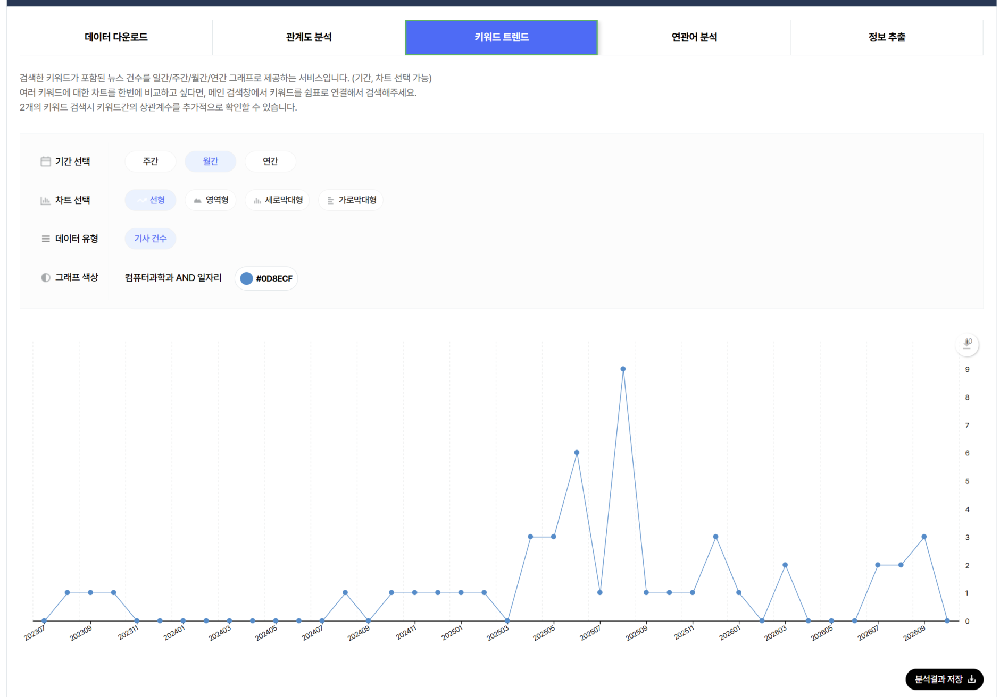
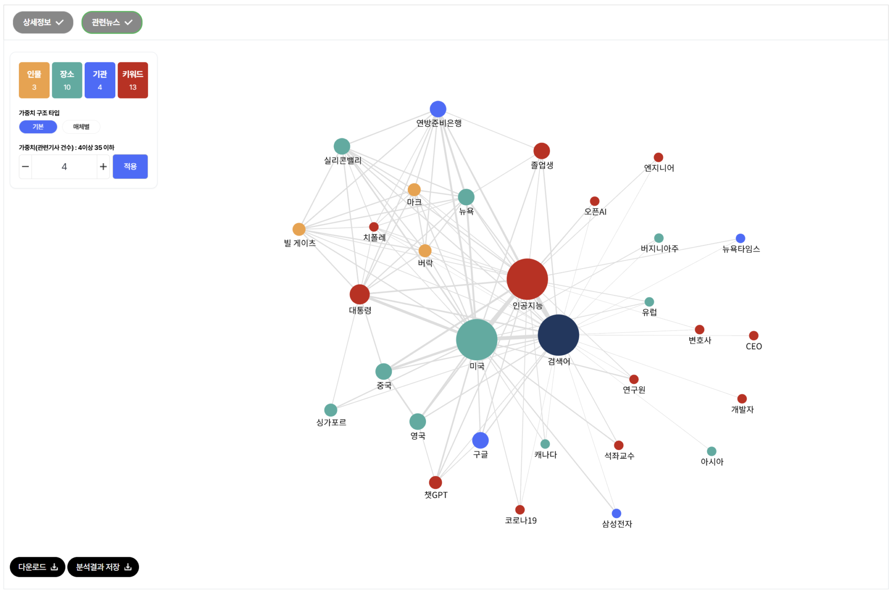
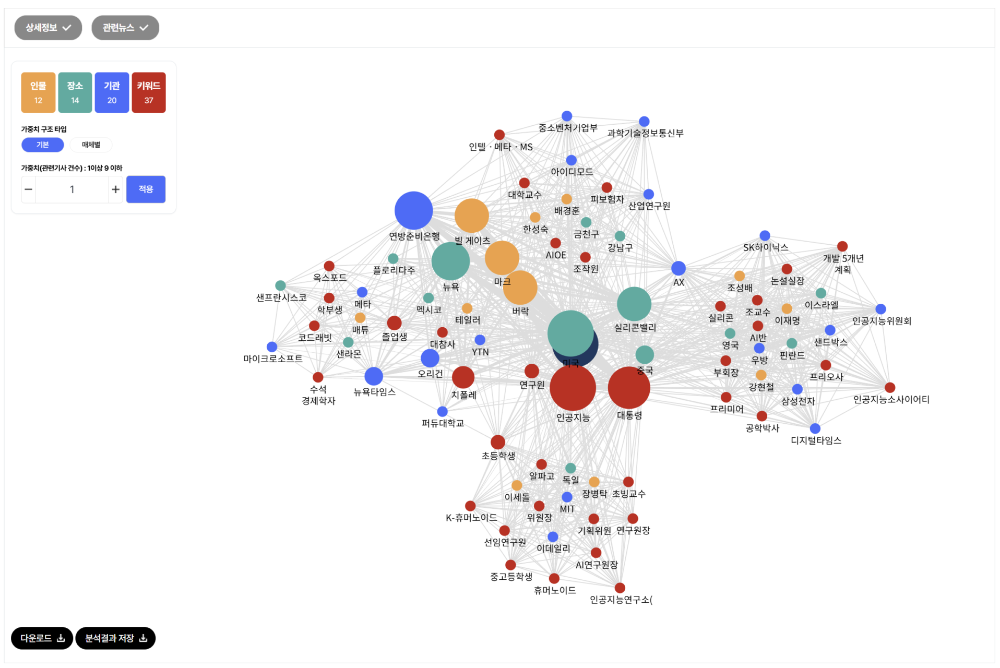
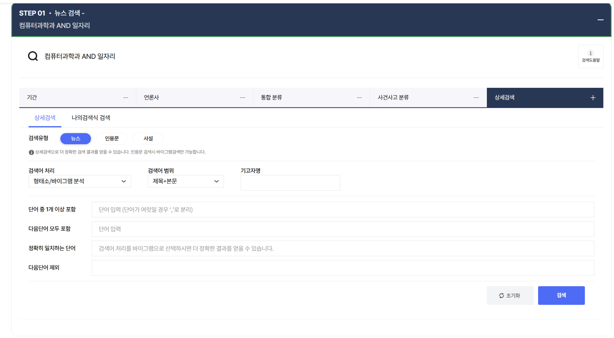
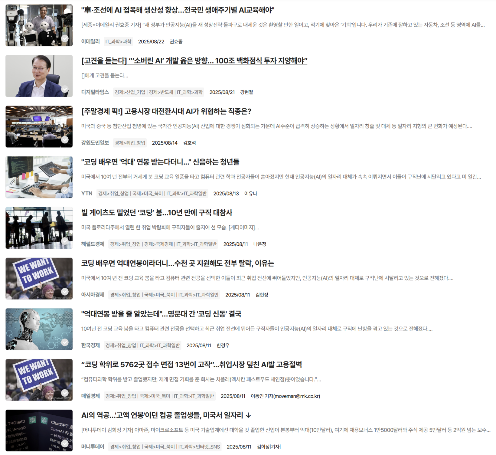
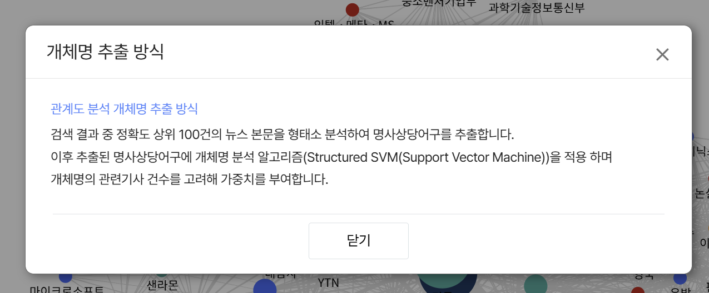

# 빅데이터의이해와활용 — 중간과제 2번 분석 결과 초안

작성일: 2026-10-12

> 사용자가 제공한 빅카인즈 검색·시각화 화면과 기사 원문을 바탕으로 작성하였다. 대화에 첨부된 원본 캡처를 이미지로 삽입했으며, 최종 제출 형식은 PDF이다. 의사결정 의견은 작성자의 검토·수정을 위한 초안이다.

## 1. 검색 조건과 시각화 결과

소속 학과인 컴퓨터과학과와 ‘일자리’를 결합하여, 컴퓨터과학 전공 및 관련 산업의 고용 문제가 뉴스에서 어떻게 다뤄지는지 살펴보았다.

| 항목 | 설정 및 결과 |
| --- | --- |
| 플랫폼 | 한국언론진흥재단 빅카인즈 |
| 검색식 | `컴퓨터과학과 AND 일자리` |
| 전체 기간 | 2023-07-12~2026-10-12 |
| 검색 유형·범위 | 뉴스, 제목+본문 |
| 검색어 처리 | 형태소/바이그램 분석 |
| 추가 조건 | 기고자명 및 추가 포함·제외어 없음 |
| 전체 검색 결과 | 49건 |
| 시간 시각화 | 월간·선형·기사 건수 |
| 전체 기간 관계도 | 가중치 구조 ‘기본’, 관련 기사 건수 하한 4 |
| 집중 분석 기간 | 2025-08-01~2025-08-31, 검색 결과 9건 |
| 집중 기간 관계도 | 가중치 구조 ‘기본’, 관련 기사 건수 하한 1 |

언론사 선택의 최종 상태는 제출 전 저장된 검색식에서 확인한다. 미선택 상태와 스포츠를 제외한 언론사 선택 상태를 시험했으나, 최종 49건 검색의 언론사 선택 내역 전체가 담긴 화면은 확보하지 않았다.

그림 1. ‘컴퓨터과학과 AND 일자리’의 월별 기사 건수. 기간: 2023-07-12~2026-10-12. 출처: 빅카인즈, 사용자 직접 검색·시각화, 2026-10-12.

그림 2. 전체 검색 기간의 개체 연결 관계. 가중치 구조: 기본, 관련 기사 건수 하한: 4. 화면상 인물 3개·장소 10개·기관 4개·키워드 13개. 출처: 빅카인즈, 2026-10-12.

그림 3. 보도량 최고점인 2025년 8월의 개체 연결 관계. 기간: 2025-08-01~2025-08-31. 가중치 구조: 기본, 관련 기사 건수 하한: 1. 화면상 인물 12개·장소 14개·기관 20개·키워드 37개. 출처: 빅카인즈, 2026-10-12.

그림 2와 그림 3은 기간과 가중치 하한이 다르므로, 노드 수나 그림의 복잡도만으로 관계의 증가·감소를 비교하지 않았다. 검색 결과 건수와 시각화에 실제 사용된 분석 기사 건수도 자동으로 동일하다고 가정하지 않았다.

## 2. 키워드 트렌드와 실제 사회적 맥락

### 2.1 보도량이 급증한 구간

월별 그래프에서 2025년 6월은 6건, 7월은 1건, 8월은 9건, 9월은 1건으로 나타났다. 전체 기간의 최고점은 2025년 8월이다. 7월보다 8건 증가한 것으로, 기사 수는 9배가 되었다. 다만 직전 달이 1건에 불과하므로 배수보다 절대 건수와 기사 내용에 주목할 필요가 있다.

8월로 기간을 제한한 검색에서도 9건이 확인되었다. 제공된 기사 목록을 제목과 요약에 따라 분류하면 다음과 같다. 아래 표는 제목을 축약한 주제 정리이며, 9건 모두의 본문을 확인했다는 의미는 아니다.

| 날짜 | 매체 | 기사 주제 | 확인 범위 |
| --- | --- | --- | --- |
| 2025-08-11 | 헤럴드경제 | 코딩 교육 열풍 이후의 구직난 | 포털에 게재된 해당 매체 본문 |
| 2025-08-11 | 아시아경제 | 컴퓨터 전공자의 반복된 취업 지원과 탈락 | 포털에 게재된 해당 매체 본문 |
| 2025-08-11 | 한국경제 | 컴퓨터 전공 청년의 취업난 | 언론사 원문 |
| 2025-08-11 | 매일경제 | 대규모 취업 지원에도 부족한 면접 기회 | 언론사 원문 |
| 2025-08-11 | 머니투데이 | 미국 컴퓨터 전공 졸업생의 일자리 문제 | 언론사 원문 |
| 2025-08-13 | YTN | 미국 코딩 전공 청년의 구직난 | 언론사 원문 |
| 2025-08-14 | 강원도민일보 | AI와 직종별 고용 변화 | 검색 목록 |
| 2025-08-21 | 디지털타임스 | 소버린 AI 투자 방향 | 검색 목록 |
| 2025-08-22 | 이데일리 | 기존 산업의 AI 활용과 생애주기별 교육 | 언론사 원문 |

미국 전공자의 구직난을 다룬 기사는 제목·요약 기준 6건으로, 해당 월 9건 중 약 66.7%를 차지했다. 특히 8월 11일에 5건이 집중되었다. 이는 여러 독립적인 사건이 각각 발생했다기보다, 특정 고용 이슈가 여러 매체에서 집중적으로 다뤄진 시기라는 해석을 뒷받침한다.

### 2.2 보도 증가와 연결되는 사건 및 산업 맥락

YTN의 8월 13일 기사는 미국 컴퓨터 관련 전공자의 구직난을 전하면서, 8월 10일 현지 뉴욕타임스 보도를 인용했다고 명시한다. 기사에서는 전공 졸업생의 취업 어려움과 함께 AI 코드 생성, 기술기업 감원, 연방정부 고용 축소 등을 배경으로 제시한다. 따라서 8월의 보도 집중은 이 해외 고용 이슈의 국내 확산과 연결해 해석할 수 있다. 추가로 8월 11일 기사 5건의 본문을 대조한 결과, 모두 8월 10일 뉴욕타임스 보도를 출처로 밝히고 있었다. 뉴욕타임스 원문 자체는 별도로 검증하지 않았으므로, 여기서 확인한 것은 국내 기사들의 출처 표기와 내용의 중첩이다. [YTN 원문](https://www.ytn.co.kr/_cs/_ln_0104_202508130938265501_005.html)

추가 5건의 인용 관계는 다음과 같다. 매체명 링크는 실제 본문을 확인한 페이지이며, 헤럴드경제와 아시아경제는 포털에 게재된 해당 매체 기사로 확인했다.

| 8월 11일 매체 | 본문에서 확인한 인용 출처·공통 사례 | 빅카인즈 식별자 |
| --- | --- | --- |
| [헤럴드경제](https://news.nate.com/view/20250811n34480) | NYT 8월 10일 보도, 미쉬라와 테일러의 구직 사례 | 02100701.20250811200113001 |
| [아시아경제](https://v.daum.net/v/20250811185911747) | NYT 8월 10일 보도, 미쉬라와 테일러의 구직 사례 | 02100801.20250811185921001 |
| [한국경제](https://www.hankyung.com/article/2025081141257) | NYT 등 8월 10일 보도, 미쉬라의 구직 사례 | 02100601.20250811174111001 |
| [매일경제](https://www.mk.co.kr/news/world/11390892) | NYT 8월 10일 보도, 미쉬라와 테일러의 구직 사례 | 02100101.20250811171012001 |
| [머니투데이](https://www.mt.co.kr/world/2025/08/11/2025081110574433826) | NYT 8월 10일 보도, 미슈라로 표기된 동일 인물의 구직 사례 | 02100201.20250811120424001 |

따라서 8월 11일의 5건과 13일 YTN 기사는 같은 해외 보도와 사례를 공유하는 보도 묶음으로 해석할 근거가 있다. 전체 9건 중 6건, 약 66.7%가 이 이슈에 해당하므로, 8월 최고점을 설명하는 주요 요인은 미국 컴퓨터 전공자의 구직난에 대한 국내 여러 매체의 집중 보도이다. 이는 해당 기간에 새로운 고용 사건이 6개 발생했다거나 독립된 연구 6개가 같은 결론을 냈다는 뜻이 아니다. 빅카인즈의 자동 중복 판정과도 별개인 내용 수준의 비교이다. 원래 그래프의 9건은 보도량으로 유지하되, 해석에서는 동일 이슈의 반복 노출을 고려한다.

국내 산업 맥락에서는 8월 22일 이데일리의 장병탁 서울대 AI연구원장 인터뷰가 대응 방향을 보여준다. 그는 자동차·조선 등 기존 산업에 AI를 적용하고, 생애주기와 직무에 맞는 교육을 추진하자고 제안했다. 이는 실제 고용 증가를 측정한 자료가 아니라 전문가의 정책·산업 제안이다. 또한 이 기사에서 ‘컴퓨터과학과’는 인터뷰 대상자의 학력에 등장하므로, 검색 결과 전체가 해당 학과 졸업생의 취업만을 직접 다루는 자료는 아니다. [이데일리 원문](https://www.edaily.co.kr/News/Read?mediaCodeNo=257&newsId=01521926642269944)

이 과제에서는 거주 지역 대신 소속 학과를 선택했으므로, 사회적 맥락을 컴퓨터과학 전공자가 진출하는 소프트웨어·AI 산업의 직무 변화와 연결한다. 미국의 취업난을 한국의 실업 실태로 그대로 일반화할 수는 없지만, 국내 전공 교육과 기업의 신입 채용에서 어떤 역량을 준비해야 하는지 검토하는 계기는 된다. 관찰된 8월 최고점은 ‘일자리 자체의 급감’이 아니라 ‘고용 불안과 AI 대응에 대한 뉴스 관심의 집중’을 보여준다.

9월의 1건으로의 감소 역시 취업난 해소를 뜻하지 않는다. 해당 검색 조건에서 후속 보도가 줄었다는 의미로 한정한다. 전체 기간의 첫 달과 마지막 달은 일부 날짜만 포함되어 있어 완전한 한 달과 직접 비교하지 않는다.

## 3. 관계도 해석과 비즈니스 의사결정 의견

### 3.1 핵심 개체와 연결 관계

전체 기간 관계도에서는 ‘미국’과 ‘인공지능’이 큰 노드로 나타나고, ‘졸업생’, ‘구글’, ‘챗GPT’, ‘연방준비은행’ 등이 연결되어 있다. 이는 뉴스가 AI와 일자리 문제를 미국의 기술·고용 상황과 함께 다루고 있다는 해석을 뒷받침한다. ‘검색어’ 노드는 검색 조건을 나타내는 중심점이므로 실제 사회적 행위자로 취급하지 않는다.

8월 관계도에서는 미국·인공지능 주변에 졸업생·연방준비은행·뉴욕타임스·치폴레 등이 나타나고, 다른 부분에는 장병탁·휴머노이드·AI연구원장 등 국내 AI 활용 논의와 관련된 개체들이 나타난다. 이를 기사 내용과 함께 읽으면 고용 불안과 산업 전환 대응이 같은 검색 결과 안에 공존한다는 점을 볼 수 있다. 이 노드들을 확인 없이 하나의 실제 협력 조직이나 공식 네트워크로 해석하지는 않는다.

빅카인즈의 화면 설명에 따르면 개체는 검색어 및 동일 뉴스에 등장하는 다른 개체와 연결된다. 제공된 ‘개체명 추출 방식’ 설명은 뉴스 본문에서 개체를 추출하고 관련 기사 수를 고려하여 가중치를 부여한다고 안내한다. 따라서 노드의 크기와 연결선의 두께는 이 검색 자료에서의 상대적 등장·연관 정도를 해석하는 단서이다.

전체 기간 그림에서는 미국과 인공지능 사이의 선이 주변의 여러 가는 선보다 굵게 보인다. 이는 두 주제가 이 뉴스 집합에서 밀접하게 함께 다뤄진다는 시각적 단서로 읽을 수 있다. 그러나 제공된 설명만으로 선 두께의 정확한 산식을 확인할 수 없어 ‘두 배 두꺼우면 기사도 두 배’처럼 수치화하지 않는다. 굵은 선을 인과관계나 실제 영향력의 크기로 해석하는 것도 피한다.

추가 기사 대조는 관계도의 해석도 보완한다. 뉴욕타임스는 이 보도 묶음에서 인용 출처이며, 치폴레는 졸업생의 구직 사례에 등장하는 음식점 체인이다. 따라서 이 노드들의 존재를 AI 기업과의 사업 제휴나 협력으로 읽는 것은 부적절하다. 여러 기사에 같은 사례가 반복되면 해당 사례의 개체와 연결이 시각적으로 강조될 수 있다. [매일경제](https://www.mk.co.kr/news/world/11390892)

가중치 하한 1의 8월 그림은 한 기사에 등장하는 개체도 표시하므로 연결이 조밀하다. 같은 내용을 여러 매체가 보도하면 특정 개체가 두드러질 수 있으며, ‘마크’, ‘버락’처럼 이름이 일부만 추출되거나 개체 유형이 부정확할 가능성도 있어 본문과 대조해야 한다.

### 3.2 나의 비즈니스 의사결정 의견 — 검토용 초안

내가 소프트웨어 기업의 채용·교육을 담당한다면, 이 결과를 근거로 신입 개발자 채용을 일괄 축소하지는 않겠다. 뉴스가 부각하는 자동화 가능성을 고려하되, 실제 업무에서 AI가 줄이는 작업과 사람이 검증해야 하는 작업을 먼저 구분하겠다. 코드 작성 속도만으로 인력을 평가하면 요구사항 해석, 오류 검증, 보안과 운영 책임을 놓칠 수 있기 때문이다.

구체적으로 신입에게 AI 도구를 허용한 소규모 개발 과제를 부여하고, 요구사항 충족 여부, 테스트의 적절성, 보안 오류, 결과를 설명하는 능력을 평가하겠다. 채용 후에는 숙련자와 함께 AI가 생성한 코드를 검토하는 교육을 운영하고, 재작업 시간·결함률·납기 개선 여부로 효과를 측정하겠다. 이는 본 분석을 바탕으로 제안하는 의사결정이며, 뉴스 자료로 이미 효과가 검증된 방안이라는 뜻은 아니다.

사업 측면에서는 고객 산업의 구체적인 문제를 해결하는 작은 실증 프로젝트부터 추진하겠다. 예를 들어 제조 현장의 문서 검색이나 검사 업무 지원에 AI를 적용하고, 정확도와 검토 비용을 측정한 뒤 확대 여부를 결정할 수 있다. 컴퓨터과학 전공자로서도 프로그래밍 기초와 함께 데이터 품질, 테스트, 산업 지식을 학습하는 방향을 선택하겠다. 뉴스의 고용 불안을 진로 포기의 근거로 삼기보다, 어떤 업무 역량에 투자할지 판단하는 출발점으로 활용하는 것이다.

## 4. 자료와 해석의 한계

- 49건과 8월 9건은 특정 검색식·기간·처리 방식의 결과이며 전체 고용 보도의 전수나 노동시장 통계가 아니다.
- 바이그램을 함께 사용하여 형태소 검색의 누락을 보완했지만, 학과명이 학력·소속으로만 등장한 기사도 포함될 수 있다.
- 9건 중 7건의 본문을 확인했다. YTN·이데일리·한국경제·매일경제·머니투데이는 언론사 페이지, 헤럴드경제·아시아경제는 포털에 게재된 해당 매체 기사로 확인했다. 강원도민일보·디지털타임스 2건은 사용자 제공 검색 목록에 기반해 주제를 분류했다.
- YTN이 인용한 해외 보도와 통계는 별도의 원자료 검증을 하지 않았다. 따라서 세부 실업률 수치를 독립적으로 검증한 사실처럼 제시하지 않았다.
- 노드·선의 해석은 뉴스 내 연관성에 관한 것이다. 실제 조직 간 협력, 인과관계, AI만의 고용 효과를 입증하지 않는다.
- 제출 전에 PDF에서 그림의 글자가 읽히는지 확인하고, 최종 언론사 조건을 확인해야 한다. Markdown을 다른 위치로 옮길 때에는 함께 제공된 `images` 폴더도 유지해야 한다.

## 참고자료

1. 한국언론진흥재단 빅카인즈. 사용자 제공 검색 조건, 키워드 트렌드, 전체 기간 및 2025년 8월 관계도, 기사 9건 목록, 개체명 추출 방식 화면. 검색일: 2026-10-12.
2. 이유나. 2025-08-13. 「“코딩 배우면 '억대' 연봉 받는다더니...” 신음하는 청년들」. [YTN 원문](https://www.ytn.co.kr/_cs/_ln_0104_202508130938265501_005.html). [사용자 제공 빅카인즈 링크](https://www.bigkinds.or.kr/v2/news/newsDetailView.do?newsId=08100401.20250813094002002).
3. 권효중. 2025-08-22. 「“車·조선에 AI 접목해 생산성 향상…전국민 생애주기별 AI교육해야”」. [이데일리 원문](https://www.edaily.co.kr/News/Read?mediaCodeNo=257&newsId=01521926642269944). [사용자 제공 빅카인즈 링크](https://www.bigkinds.or.kr/v2/news/newsDetailView.do?newsId=04101008.20250822050157002).

4. 나은정. 2025-08-11. 「빌 게이츠도 밀었던 ‘코딩’ 붐…10년 만에 구직 대참사」. 헤럴드경제. [네이트 게재 본문](https://news.nate.com/view/20250811n34480).
5. 김현정. 2025-08-11. 「코딩 배우면 억대연봉이라더니…수천 곳 지원해도 전부 탈락, 이유는」. 아시아경제. [다음 게재 본문](https://v.daum.net/v/20250811185911747).
6. 한경우. 2025-08-11. 「“억대연봉 받을 줄 알았는데”…명문대 간 ‘코딩 신동’ 결국」. [한국경제](https://www.hankyung.com/article/2025081141257).
7. 이동인. 2025-08-11. 「“코딩 학위로 5762곳 접수 면접 13번이 고작”…취업시장 덮친 AI발 고용절벽」. [매일경제](https://www.mk.co.kr/news/world/11390892).
8. 김희정. 2025-08-11. 「AI의 역공…‘고액 연봉’이던 컴공 졸업생들, 미국서 일자리 ↓」. [머니투데이](https://www.mt.co.kr/world/2025/08/11/2025081110574433826).

빅카인즈 상세 기사 링크는 조사 도구에서 열리지 않아 제목·날짜·기자를 대조할 수 있는 언론사 페이지 또는 해당 매체의 포털 게재 본문을 이용했다. 확인일: 2026-10-12.

## 부록: 검색 및 분석 근거 화면

아래는 본문 분석의 확인용 자료이다. 제출본의 분량에 따라 부록 포함 여부를 결정할 수 있다.

### A. 검색 조건

### B. 2025년 8월 기사 9건

### C. 개체명 추출 방식

